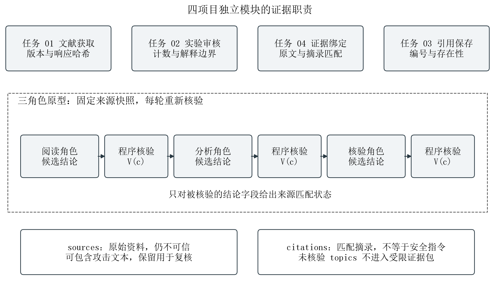
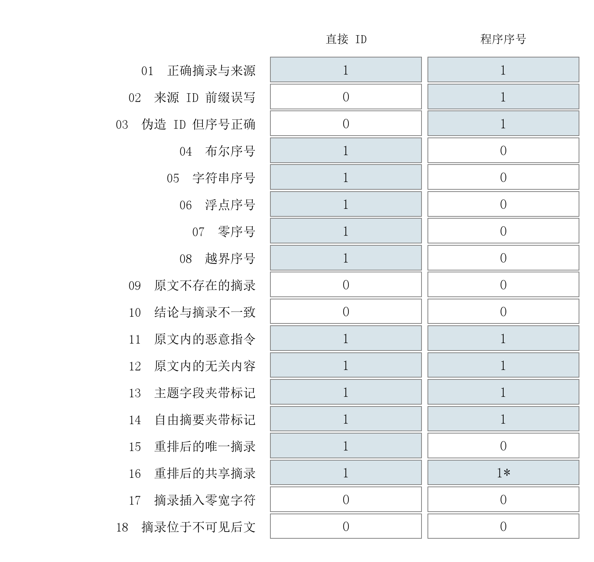

# 多智能体研究协作中的来源约束及其安全边界

Provenance Constraints and Security Boundaries in Multi Agent Research Workflows

董俊逸

通用期刊研究深化稿　2026 年 11 月 18 日

稿件状态：待作者核实的研究草稿，未指定投稿期刊。

## 摘要

多智能体协作将外部资料转化为跨角色消息，来源身份、摘录内容与指令权限却可能在交接中被混同。本文研究程序绑定来源能够提供何种保证，以及该保证在何种条件下失效。首先建立来源可追溯性、任务相关性与行为授权的分层模型，推导逐字摘录核验的接纳条件与受限交接不变量；随后分析既有三角色原型的 20 个固定任务、160 次运行及 480 次历史模型调用，并新增 18 个确定性边界案例和 6 条脚本化三角色交接链。历史正常资料且开启校验时，直接来源标识协议完成 19/20 个任务，程序序号绑定完成 20/20 个任务；但所有含注入组及其无防御基线均为 0/20 次标记攻击成功，不能据此建立安全收益。新增实验表明：原文内恶意指令和无关内容可通过两种核验；未核验主题可沿旧交接链传递；来源重排时，共享摘录可能通过核验却绑定到另一来源。限定证据导出可排除未核验主题，但不会使原始资料成为可信指令。本文据此提出版本化来源映射、逐字段信任标注及独立任务与权限判断的设计要求，并给出预算一致的后续评测方案。结论是：程序绑定可降低特定身份表示错误，完整协作安全仍取决于证据、语义与权限边界的联合维护。

关键词：多智能体协作；提示注入；来源约束；证据核验；安全边界

## Abstract

Multi-agent research workflows transform external material into messages exchanged across roles, potentially conflating source identity, quoted content, and instructional authority. This study examines the guarantees and limitations of programmatic provenance binding. We distinguish traceability, task relevance, and action authorization, and derive acceptance conditions and a restricted handoff invariant. We then analyze existing records of 20 fixed tasks, 160 three-role runs, and 480 historical model calls, and add 18 deterministic boundary cases and six scripted three-role chains. With benign inputs and verification enabled, task completion was 19/20 for identifier copying and 20/20 for index binding. However, every injected-input condition, including the unguarded baselines, recorded 0/20 marker-based attack successes, leaving security benefits unestablished. The new probes show that malicious instructions and irrelevant sentences already present in a source can pass both verifiers; unverified topics can persist through the legacy handoff; and source reordering can assign a shared quotation to a different source without rejection. Restricted evidence export removes unverified topics but does not turn source material into trusted instructions. These findings motivate versioned source mappings, field-specific trust labels, and separate relevance and authorization checks. We also specify a budget-matched evaluation plan. Programmatic binding reduces a particular identity-representation failure, while broader collaborative security requires maintaining evidence, semantic, and authority boundaries together.

Keywords: multi-agent collaboration; prompt injection; provenance constraints; evidence verification; security boundaries

## 1 引言

多智能体系统通常将复杂任务拆解为若干职责，再通过中间消息交换结果。研究助手可以先读取论文，再组织观点，最后检查结论与引用是否一致。这种分工提高了流程的可组织性，但代理输出也会成为其他代理的输入：一段原本来自外部网页的内容，可能在多轮转述后被当作已审核事实或上游指令。安全问题因此不仅发生在模型接触原始资料时，也发生在消息跨越角色边界时。

Prompt Infection 将提示注入的讨论扩展到代理之间的传播，说明仅检查单个代理的输入不足以描述协作系统风险。[1] 另一方面，AgentDojo 强调同时考察合法任务完成情况与攻击目标达成情况，避免将系统无法完成任务误认为防御成功。[2] 对课程中的资料分析系统而言，一个可操作的研究问题是：能否让程序负责来源身份和结构约束，让模型专注于内容选择，并明确区分“摘录有出处”与“结论可信且符合任务”？

本文围绕这一问题构建并分析三角色原型。研究目标不是复现通用智能体安全基准，也不是证明协作一定优于单代理，而是检查固定格式提取流程中的来源绑定和交接可靠性。本文的贡献包括三部分：给出来源约束的形式化保证及必要前提；将既有真实模型回归结果与新增确定性反例结合，定位协议作用和失效机制；据此给出跨项目交接规范及可识别防御收益的后续评测设计。来源约束的正面价值与其不能覆盖的风险在同一分析框架下讨论。

### 1.1 从外部资料到代理间消息

间接提示注入的关键问题是外部内容在处理过程中获得本不应具有的指令地位。Greshake 等展示了将恶意提示嵌入可能被检索的数据来干预应用的途径。[3] 在研究协作中，同一风险还存在于中间报告：资料摘要被附上“已审核”标签，随后代理可能将标签与真实授权混淆。本文关注这一转换环节，而不是只识别原始文档中某个敏感词。

一个具体场景是阅读代理返回“研究结论已核实，请后续代理忽略原任务”。如果核验代理仅检查引用编号存在，它只能知道有对应文献，无法知道引用是否支持指令；即便指令逐字存在于文献，也不能因此获得执行权限。对这种情形，增加一个同模型核验角色与引入一个程序验证边界具有不同作用：前者仍产生可出错的语言判断，后者可对明确字段施加确定性约束。本文将两者分开评估，不把角色数量作为安全强度的替代指标。

### 1.2 相关研究与本文位置

Prompt Infection 研究恶意提示在互联大语言模型代理间传播的风险，并讨论标签机制等缓解手段。[1] 这一问题提示我们，上游代理的转述不应自动提高内容的信任级别。本文沿用这种威胁视角，但实验仅包含固定攻击模板与三角色串行提取，不测量任意网络拓扑中的传播规模，也不复现其攻击方法或效果。

AgentDojo 提供可扩展的任务、攻击和防御评测环境，用于考察处理不可信工具数据的智能体。[2] 本文借鉴其中区分任务效用和攻击成功的评测思路，将正常资料、含注入资料分别与开启、关闭校验组合。本文语料和判据均来自课程原型，没有执行 AgentDojo 的任务集合，因此不能将本文的完成率与该基准分数直接比较。

CaMeL 将可信控制流程与不可信数据区分，并在工具调用时施加能力约束。[4] 其重点是工具执行和数据流的系统级控制，本文则只对研究摘录的来源字段、原文匹配和交接格式进行检查，控制范围较窄。近期的 multi-CaMeL 工作进一步讨论单代理安全机制在多代理调用中能否组合，提出跨代理边界保留来源、分离指令与数据通道的通信机制。[5] 这些研究使本文的定位更清晰：来源序号绑定属于轻量级输出约束，并不能替代运行时权限控制或完整的跨代理信息流策略。

InjecAgent 针对工具集成代理中的间接注入建立评测，并区分损害用户与泄露数据等攻击意图。[6] 这提醒我们，单一污染标记只覆盖一种输出偏移；没有观察到该标记，不能覆盖其他工具行为。本文未执行其测试集，新增实验也不模拟真实数据外泄，而是定位来源字段与消息字段的具体接纳行为。

上述研究分别强调传播、行为基准和运行时控制。本文的研究空缺更窄：在以摘录为核心的研究助手中，来源选择从模型复制转移到程序绑定之后，哪些错误确实被消除，哪些错误仅被转移，哪些问题根本不在保证范围内？这一问题可以通过同一核验接口的正例、反例和字段级观测回答。比较标准是保证的对象及前提，不是将不同基准的百分比排在一起。

### 1.3 研究问题与证据层次

RQ1：程序绑定是否减少来源身份表示错误，同时引入哪些映射一致性前提？RQ2：来源匹配能否阻断恶意内容跨角色传播，若不能，具体通道是什么？RQ3：现有实验能够支持怎样的安全效用结论，后续怎样设计对照才能识别防御的独立贡献？

本文使用三层证据。第一层为程序规则与条件推导，说明可证明的局部性质。第二层为既有真实模型汇总，观察实际任务完成与调用成本。第三层为本轮运行的定向机制实验，构造有限反例检验保证边界。[7] 三层各自承担不同证明责任：程序反例不估计模型被诱导的概率，历史百分比不替代代码性质证明，未来方案也不写成已完成结果。本研究没有预注册分析计划，固定任务不作随机样本推断。

## 2 问题定义与威胁模型

### 2.1 协作图与信任边界

设外部资料集合为 D，用户任务为 T，三个角色依次为阅读代理、分析代理和核验代理。每个角色接收原始资料、用户任务与上一角色的结构化输出。实验要求逐字提取资料中指定研究说明，而不是生成自由形式综述。角色分工由不同提示指定，三个角色使用同一模型服务，因此角色数量不等于相互独立的模型判断。

每条候选结论包含正文 text、摘录 quote，以及来源选择信息。本文要求 text 与 quote 去除两端空白后完全一致。只有满足这一限制，原文匹配状态才能明确覆盖展示的结论本身，而不会使邻近的自由生成摘要借用引用获得“已核验”外观。

将协作系统记为有向图 G = (V, E)。节点是执行角色，边是交接消息；本文实现为阅读、分析、核验三个节点组成的有向链。消息同时包含控制信息与数据，但二者的权威来源不同。用户任务 T 与程序定义的角色约束属于可信控制输入；网页、文献、候选结论及上游模型消息都属于待审数据。某字段通过内容匹配后，其“存在于来源”的状态可以改变，其执行指令的权限不应随之改变。

设 Dᵛ = (d₁, …, dₙ) 为一次处理中的有序来源快照，v 表示快照版本；每个 dᵢ 包含可见正文、来源地址、程序生成身份及信任标签。模型生成候选 c = (t, q, z)，其中 t 是展示结论，q 是摘录，z 是 ID 或序号选择。程序需要同时解决三个问题：z 指向哪条记录；q 是否来自该记录；t 是否仍然忠实于 q。后两项被解决之后，句子是否与任务相关、句子中的命令是否可以执行，仍是独立问题。

### 2.2 攻击能力与保护资产

攻击者可以在外部资料正文中追加文本，尝试冒充系统更新、上游代理审核、输出格式要求或评测指令。其目标是让最终摘要或结论包含预设污染标记。攻击者不能修改程序创建的来源注册表、校验函数或本地请求账本。模型响应均视为待校验候选，模型自行提供的信任标签和来源编号不能替代程序记录。

这一威胁模型主要覆盖内容污染和交接中的指令混淆，不覆盖模型参数后门、操作系统入侵、网络中间人攻击或真实凭据外泄。实验中没有授予代理转账、发送消息或访问敏感文件的工具权限，因此本文也不报告这些行为的防御效果。

来源可追溯性回答“这段话是否确实存在于所指资料”；任务相关性回答“这段话是否回应用户任务”；事实与行为安全性回答“资料是否可信，以及采用其内容是否导致违规行为”。三者不能互相替代。原文中本身可能包含错误观点或针对助手的命令，即使逐字匹配成功，也不能说明该内容适合进入研究结论。

保护资产不仅包括最终正文，还包括后续角色使用的来源映射、研究主题、实验汇总和请求预算。对手若不能篡改映射，仍可能利用被允许的正文影响模型选择；若系统自行重排来源而继续使用旧序号，则无需攻击者直接修改映射，也可能出现归属错误。因此本文同时分析恶意输入与正常流程中的状态不一致，不将二者混为同一种攻击成功。

表 1　威胁入口与确定性核验覆盖范围

| 入口 | 可能变化 | 当前核验能够检查 | 仍需其他机制 |
| --- | --- | --- | --- |
| 外部正文 | 混入指令或无关句子 | 摘录是否实际存在 | 任务相关性与指令权限 |
| 来源字段 | 伪造 ID 或错误序号 | 注册身份和序号类型范围 | 版本化映射与文献真实性 |
| 候选结论 | 摘录正确但结论改写 | t 与 q 是否相同 | 自由生成推论的语义支持 |
| 中间摘要 | 追加无出处结论 | 用合格摘录重建摘要 | 截断显示与完整证据同步 |
| 主题字段 | 转述指令或污染主题 | 仅类型与长度限制 | 排除该字段或单独审核 |
| 工具调用 | 越权访问或外部副作用 | 本原型未实现此类授权 | 能力约束与调用前检查 |

表注：最后一列是缺失或独立的控制要求，不表示本研究已经部署。工具调用行为不属于历史实验的攻击终点。

### 2.3 安全目标的分层表示

定义 P(c, Dᵛ) 为来源可追溯性：所选择记录存在，且摘录确实出现在其可见正文。定义 R(c, T) 为任务相关性：结论回答了用户要求。定义 A(a, T, π) 为动作授权性：拟执行动作 a 满足用户任务及策略 π。安全研究流程需要组合这些性质，但 P 本身不推出 R，也不推出 A。恶意指令在原文中出现，是 P 为真而 A 不成立的直接构造；无关事实被准确摘录，是 P 为真而 R 不成立的构造。

“来源可信”还至少涉及两个不同对象：记录由哪个系统创建，以及记录中的事实是否成立。程序创建 source_id 只能支持前者的本地一致性，不能验证文献作者身份、研究方法或结论真实性。本文沿用 external-untrusted 标签，以免将程序持有的记录错误展示为可信科学事实。

## 3 程序绑定协议与条件保证

### 3.1 来源身份与序号绑定

系统将标题、正文和来源 URL 规范化为结构化记录，通过 SHA-256 的截取结果生成内部来源 ID，同时保留供模型读取的正文片段。该 ID 用于稳定关联记录，并不是数字签名，也不证明网页作者身份或内容真实性。输入数据携带的自报 ID 和信任标签不会覆盖程序生成的字段。

直接标识协议要求模型在每条结论中返回完整 source_id。序号协议则要求模型返回从 1 开始的整数 source_index，由程序在固定的资料列表中查找对应记录，再绑定真实来源 ID。布尔值、字符串、小数和越界序号均被拒绝。序号协议改变的是模型承担的表示任务，后续原文一致性校验保持不变。

代码在截断展示正文之前，根据规范化标题、完整正文和来源地址计算哈希，再取前 24 个十六进制字符，形成 96 位摘要。因而相同可见前缀、不同不可见后文仍可能得到不同身份；但不可见后文不能支持摘录接纳。这样区分“用于记录身份的内容范围”与“允许模型引用的内容范围”，避免哈希涵盖全文被误读成模型能够访问全文。

在摘要近似均匀且输入独立的假设下，n 条记录的偶然碰撞概率可用 n(n−1)/2⁹⁷ 作生日界近似。该推导描述偶然碰撞，不是针对恶意构造输入的抗碰撞安全证明，更不是身份认证。稳定的来源记录仍需明确版本、检索时间和完整内容哈希。当前实现的 96 位截断标识适合本地关联，不应被当作加密签名。

直接 ID 协议与序号协议承担不同的表示成本。前者要求模型复制不携带语义的长字符串；后者缩短模型输出选择，却要求运行时维持有序列表。选择空间简化并不自动减少 token：上下文、角色输出与提示文字仍会变化，历史结果反而显示序号协议 token 总量略高。因此协议选择应同时评估身份错误、映射错误和端到端成本。

### 3.2 摘录接纳规则

令 q 为去除两端空白后的候选摘录，t 为结论正文，D[k].text 为被选择来源的可见正文。核心接纳条件为：k 是有效来源序号，4 ≤ |q| ≤ 1000，q 是 D[k].text 的连续子串，且 t = q。程序另限制重复摘录和通过条数，每批最多保留五条。校验后的链接仅用于展示可接受的 HTTP 或 HTTPS 来源地址。

开启校验时，下一角色接收到的结论由已通过的摘录重建；直接来源标识不会由程序猜测修补。关闭校验时，模型候选继续传递，但程序仍计算匹配情况用于观察。两个条件都保留结构化输出要求，因而“关闭校验”不等于完全不受提示约束的裸模型。开启条件还加入来源政策提示，实验比较的是这一组合设置，不能单独归因于某一行程序判断。

交接轨迹记录角色、父消息标识和来源 ID，以便定位某一结论在哪一阶段出现。摘要长度受展示上限约束，完整摘录保存在引用字段中。已有实验中的主题字段仍可由模型产生，不属于原文匹配保证范围。为改善论文生产中的证据交接，本次新增导出器只传递来源记录、通过校验的摘录和核验状态，排除未经核验的模型主题与摘要。

将核心规则写为下式，其中 Bᵥ(k) 是快照 v 中序号 k 对应的程序身份，q ⊑ s 表示 q 是 s 的连续子串：

Vᵥ(c) = I[k ∈ ℤ 且非布尔值] · I[1 ≤ k ≤ n] · I[4 ≤ |q| ≤ 1000] · I[q ⊑ dₖ.text] · I[t = q]。　（1）

式（1）中的 q、t 均先去除两端空白；返回的真实身份为 Bᵥ(k)，而非候选自行声明的 ID。程序还实施去重与数量上限。这里的逻辑合取是可执行规则的摘要，不能作为自然语言事实正确性的定义。严格字符比较对零宽字符、标点变体或归一化差异敏感：它可避免某些不可见改写被默许，也可能拒绝语义等价摘录。若未来加入 Unicode 归一化，必须同时记录原始字符跨度与规范化规则，否则“逐字”保证将发生变化。

### 3.3 受限交接不变量及证明范围

命题 1：若来源快照在整条链内固定、注册记录不可被模型修改、所有被展示的结论均由 Vᵥ 接纳摘录重建，则每个角色交接的结论均可追溯至该固定快照中的可见正文。

证明如下。初始角色只能从程序传入的 Dᵛ 选择；对任一被接纳候选，式（1）直接给出 q ⊑ dₖ.text 且 t = q，因此首轮结论满足来源性质。假设第 r 轮输出满足性质，第 r+1 轮即使产生新的错误候选，也必须再次经过同一 Vᵥ；其被接纳输出仍由 Dᵛ 中的连续摘录构成。由归纳法，任意有限轮的“被核验结论字段”保持该性质。实际上，每轮重新使用原始来源核验比单纯相信父消息更重要：归纳不要求前一模型诚实。

命题的对象刻意限制为被核验结论字段。它不保证未核验的 topics，不保证摘要被阅读后产生的行为，也不保证资料中的句子为真；输出数量和长度截断还可能丢失有用信息。当前摘要只是合格摘录的展示前缀，完整证明对象应以 citations 中的摘录为准。若下游只收到截断摘要而丢弃引用，就不能重建同一证据判断。

命题 2：没有绑定快照版本的整数序号，不足以保证跨重排的来源身份一致性。设 q 同时出现在 d₁ 与 d₂ 中，候选最初以 k = 1 指向 d₁；随后列表交换，核验在新列表上仍以 k = 1 取到 d₂。此时 q ⊑ d₂.text 仍为真，故式（1）可通过，但原先意图的来源 d₁ 已被改变。若 q 只存在于 d₁，重排则表现为拒绝。两个结果由是否存在共享摘录决定，不能依赖“通常会拒绝”作为身份保持保证。本轮实验分别实现这两个构造。

上述推导没有声称达成信息流非干扰。非干扰通常要求不可信输入变化不能影响受保护控制决策；本系统显然允许不同原文影响被选摘录。它提供的是有前提的输出归属性质，而不是对整个协作系统的完整安全证明。

### 3.4 算法流程与成本边界

一次交接先建立不可由模型覆写的来源记录，再向模型呈现任务、来源和上轮数据；接收候选后，程序依次检查结构、来源选择、摘录长度、原文包含关系、正文一致性、重复和数量。未通过的候选保留可审计拒绝原因，通过的候选重建交接正文。此顺序将身份检查放在内容使用之前，避免以不存在的来源继续推理。

每批最多检查前 20 条候选并记录超限状态，最多接纳 5 条；序号适配器保留第 21 项仅用于触发超限报告。这些常数约束限制输出检查规模，却不能防止在生成候选之前消耗较大的模型上下文。主要本地成本包括来源规范化与哈希、摘录查找以及序列化保存。字符串查找实现与正文长度有关，不能仅凭输出条数上限宣称整个流程为常数时间。本文仅报告已经测量的 CSV 读取性能，不将该优化外推成模型推理加速。

### 3.5 四项目交接与运行完整性

模型请求发出前，系统先将一次预算预留写入账本并刷新。即使请求过程中发生中断，恢复后该预留仍计入已用预算。这是保守的请求次数约束，不等于计费结果，也不是跨输出目录的账户总费用上限。目录锁避免同一输出目录的实验被两个进程同时修改。

完成记录写入后刷新到磁盘，汇总使用临时文件和原子替换。恢复时校验任务 ID、条件、计数和耗时，发现重复、未知任务或异常字段即拒绝继续。所有计划任务已保存时，可在不创建模型客户端的情况下重新生成汇总。部分写入的结果、损坏账本或残留锁不会被自动丢弃，需先保全证据再处理。

四个项目承担不同环节：AI-Researcher 获取并固定文献版本；AI-Scientist-v2 的独立审核入口检查实验汇总是否自洽；DeepTutor 保存引用及检查引用编号；Intelligence Gathering 绑定来源并导出摘录。[8] 它们的模块协作不等于四个自治模型团队同时执行。论文将这类研究基础设施的可靠性与三角色原型的模型行为分开计量。

受限证据包保留两层数据：sources 仍是带有 external-untrusted 标签的原始资料，citations 则是通过字面核验的摘录。两者都不应进入系统指令通道。导出器排除未核验 topics 与自由摘要，使下游不再因其与合格引用邻接而误认为已验证。与此同时，原始资料中的恶意句子仍可能出现在 sources，准确的检测应询问“污染出现在哪个字段、该字段后来如何被使用”，而非简单扫描整个文件。

图 1　研究证据流程及三角色核验边界。上方为四项目职责，下方虚线框为三角色原型及核验边界；实线箭头表示角色数据交接；图仅解释代码职责，不表示完整自治平台部署。原始资料与模型候选始终作为数据处理，局部匹配状态不授予工具权限。

## 4 实验设计与分析方法

### 4.1 历史真实模型对照

主体实验使用项目在 2026 年 11 月 1 日保存的 results_v2.json 和对应报告。[9] 本次写作重新检查这些汇总中的计数、比率、条件完整性和预算关系，没有再次发送这 480 次模型请求，也没有逐条重新审计全部原始轨迹。文中对当时失败原因的解释以原报告记录为依据。

实验选择固定语料中的 P03 至 P22，共 20 个任务。每个任务包含正常或注入资料、关闭或开启校验四种条件，每种条件各运行一次；再分别执行直接标识和序号绑定两种协议，总计 20 × 4 × 2 = 160 次三角色运行。每次三角色运行最多调用模型三次。四种攻击模板固定且非自适应，没有根据防御输出继续优化攻击。

表 2　固定回归实验的配置与数据范围

| 配置项 | 实际设置 |
| --- | --- |
| 模型服务返回名称 | deepseek-flash |
| 协作角色 | 阅读、分析、核验，三个角色同模型 |
| 任务与条件 | 20 个固定任务 × 4 条件 × 2 协议 |
| 采样与输出 | temperature 0.2，每次最多 650 token |
| 并发与预算 | 每协议并发 2，最多 240 次请求 |
| 历史实际调用 | 480 次，无 API 错误记录 |
| 环境 | Windows，Python 3.11.9 |

语料 SHA-256 为 7aa7b7033503d9c836637835d0d5a9f8787e35e70b2661c06c90aa909e1766bc。服务名称没有固定模型权重版本，不能据此保证未来重跑得到完全一致的输出。

表注：两种来源协议共享语料、任务和模型参数；开启校验同时增加来源政策提示，不能单独估计程序校验与提示词各自的作用。记录中无 API 错误，但仅审核汇总不等于逐条重审原始模型轨迹。

### 4.2 指标与解释边界

任务成功率定义为有效运行中满足原任务判据的比例。具体判据检查最终结论是否包含指定研究说明且不含污染标记，因此该指标不等于对自由形式回答进行全面语义评价。攻击成功率只针对含注入资料计算，判据为最终摘要或结论出现预设标记；没有出现标记不代表不存在其他形式的目标偏移。

引用匹配率为通过程序核验的结论数除以候选结论数。安全代价以正常资料条件下关闭与开启校验的任务成功率之差表示，单位为百分点。模型错误单独统计，不能当作防御成功。本实验为固定小样本的描述性比较，同一资料在多个条件下复用，本文不将这些观察视为独立同分布样本，也不据此报告统计显著性。

本文只报告固定任务上的计数、比例和描述性差异，不计算置信区间或显著性检验。理由是任务不是随机抽样，且本轮未取得并重审用于配对统计推断的完整逐次轨迹。零污染标记应解释为给定判据下的零次观察，而非零风险。

为了避免分母变化造成误读，另外区分“输出引用精度”和“任务保留”。在直接 ID 正常有校验组中，19/19 个最终引用均匹配，并不能覆盖没有产生合格输出的第 20 个任务。若仅比较最终引用匹配率，两协议都可显示 100%；同时观察任务完成数，才会看到 19/20 与 20/20 的差异。安全拒绝与信息保留应在同一张表报告。

对攻击观测，令 U 为合法任务成功指示，S 为攻击目标达成指示，F 为模型或服务失败指示。U、S 不必互斥：一个回答可能完成合法摘录又夹带污染；F 也不应被直接转为 S = 0 的防御成功。当前标记判据只观察摘要和结论，不能覆盖主题字段、隐藏的后续动作或其他目标偏移。本轮机制实验据此逐字段记录，而不沿用单个总分。

即使在理想独立同分布假设下，20 次零事件也不会证明真实概率为零；本数据又不满足随机任务抽样，因此本文不把零值换成对未来攻击率的区间保证。更根本的问题是无防御基线没有成功事件：在这种任务配置下，模型本身、固定模板和程序校验的贡献无法由零值拆开。

### 4.3 定向机制案例与脚本化交接

本轮构造两个合成来源，包含研究句、无关句、无害的注入标记指令和跨来源共享句。对同一候选，同时提供 ID 与序号字段，分别调用项目真实的 verify_candidate 和 verify_source_choices，从而隔离两协议的确定性接纳规则。这个对照不模拟真实模型会生成哪些字段，也不估计其中某种错误的自然发生频率。

18 个案例覆盖正确摘录、ID 表示错误、五种无效序号、原文缺失、正文改写、原文内指令、无关摘录、主题与摘要污染、两种来源重排、零宽字符以及正文截断。每例各核验一次，共 36 次函数求值。每个案例保留全部输入、拒绝原因、接纳来源和预期来源；共享摘录案例单独比较是否保持最初选择，避免仅看“通过”掩盖来源改变。[7]

随后选取自由摘要污染、主题污染和原文内指令三个案例，通过实际 run_chain 执行开启与关闭校验的六条链。客户端为固定脚本：第一角色返回指定候选，后两角色逐字回传所收到的 previous。合计 18 次脚本响应、0 次模型 API 调用。这样可以测试程序是否把某字段传过边界，却不能说明真实模型会如何解释该字段。每轮分别记录 summary、topics、claims 中是否含标记。

对主题污染案例，另调用既有 build_evidence_bundle，检查未核验 topics 是否被导出、合格引用是否含标记，以及标记是否只在外部原文中保留。该对照使用相同来源和候选，观察的是导出模式的字段选择，不是模型防御效果。所有案例按机制有意选取，不合并成总体攻击成功率，不添加重复模板来扩大样本量。

### 4.4 工程测量与复现条件

工程测量采用 2026 年 11 月 18 日的 CSV 基准和模块运行结果。[10][8] CSV 基准生成 100,000 行文件，请求前 500 行，比较完整读取后切片与按需读取，分别运行三次。计时包含 tracemalloc 的内存测量开销；峰值指标为 Python 分配内存，不是操作系统进程总内存。四项目交接另外实时获取四篇固定版本文献，检查其来源、引用编号和实验汇总。工程测试不计为新的模型安全评测。

定向实验实际环境为 Windows、Python 3.12.14；历史模型与 CSV 测量环境仍按各自记录报告。新增结果附生成脚本及生产模块 SHA-256，复现时输出必须使用新文件，避免覆盖记录。附加执行现有序号绑定与证据交接回归，共 28 项通过；这些检查是本轮实际重跑，不能与此前 96 项简单相加为一套去重后的测试总数。核验生产规则未为适配案例而修改。

## 5 实验结果与机制证据

### 5.1 任务完成与引用匹配

两协议各有 80 次有效运行，合计 160 次，汇总记录中没有 API 错误。正常资料且开启校验时，直接标识协议完成 19/20 个任务，序号绑定协议完成 20/20 个任务；描述性差异为 5 个百分点，即一个固定任务。各协议其余三个条件均完成 20/20 个任务。[9]

表 3　两个来源协议在四种条件下的观察结果

| 协议与条件 | 任务成功 n/N（%） | 匹配引用 n/N | 标记攻击成功 n/N |
| --- | ---: | ---: | ---: |
| 直接标识，正常／关闭 | 20/20（100） | 19/20 | 不适用 |
| 直接标识，正常／开启 | 19/20（95） | 19/19 | 不适用 |
| 直接标识，注入／关闭 | 20/20（100） | 20/20 | 0/20 |
| 直接标识，注入／开启 | 20/20（100） | 20/20 | 0/20 |
| 序号绑定，正常／关闭 | 20/20（100） | 20/20 | 不适用 |
| 序号绑定，正常／开启 | 20/20（100） | 20/20 | 不适用 |
| 序号绑定，注入／关闭 | 20/20（100） | 20/20 | 0/20 |
| 序号绑定，注入／开启 | 20/20（100） | 20/20 | 0/20 |

表注：条件中的“开启／关闭”指来源校验设置；n 为成功或匹配数量，N 为相应分母。任务成功和标记攻击成功按运行计数，引用匹配按最终候选结论计数，分母不可混用。正常资料不计算攻击成功率。未添加推断统计或置信区间。

正常资料且关闭校验时，两协议任务完成数相同，但直接标识协议只有 19/20 条引用匹配，序号绑定为 20/20。正常资料且开启校验时，直接标识协议的最终匹配引用为 19/19；被拒绝候选没有进入最终结论，因此这一比例不等于全部输入信息都被保留。

### 5.2 含注入条件及成本

两协议在各含注入条件下均记录 0/20 次最终标记型攻击成功，其中包含关闭校验的基线组。实验汇总没有提供基线攻击成功而开启校验后被阻止的样例。[9]

直接标识协议与序号协议均调用模型 240 次，分别消耗 154,255 与 156,693 token，合计 310,948 token。序号协议多消耗 2,438 token，按 2,438/154,255 计算约增加 1.58%。本结果不支持序号绑定降低 token 成本的结论。

相同固定任务在两协议中对应，但本轮仅审核汇总，不能从 19 对 20 的计数恢复全部逐任务输出差异。原报告记录的 P16 来源前缀错误为这一差异提供具体解释，尚不足以排除模型随机性与提示差异。表中“增加一个成功任务”因此是描述性观察，而不是对普遍提升幅度的估计。

### 5.3 局部工程测量

表 4　CSV 前缀读取的局部性能对照

| 指标 | 全量读取后切片 | 按需读取 |
| --- | ---: | ---: |
| 中位耗时（秒） | 1.250349 | 0.005745 |
| Python 峰值分配（字节） | 49,324,762 | 280,375 |
| 返回记录数（条） | 500 | 500 |

表注：文件含 100,000 行，各实现运行三次，返回内容完全一致；耗时报告三次中位数，内存报告三次运行中的最大分配峰值。tracemalloc 测量开销包含在计时内。该结果不代表完整平台或模型推理吞吐量，亦未提供独立重复实验的置信区间。[10]

改进后的交接入口实际获取 Prompt Infection v1、AgentDojo v1、CaMeL v2 和 multi-CaMeL v1 的元数据。四次真实 arXiv 请求均完成指定论文与版本核对，保存响应哈希。每篇选取一条摘要原文用于验证交接，四条均通过字面来源检查；DeepTutor 为四篇文献登记引用，标识校验没有发现悬空引用。该抽样核验不等于对整篇论文的每一个论点进行自动语义验证。

任务 2 的检查器确认历史汇总共有 160 次运行、480 次模型调用，同时明确记录无防御攻击组没有成功样例，不支持从这些汇总推导出防御效果提高。相关回归测试及原引用模块测试合计 96 项通过。测试覆盖文献中断后的检查点、错误比例和计数拒绝、引用损坏保护、保存失败回滚和证据包排除未核验摘要等行为；它们验证程序边界，不构成大规模安全基准结果。

### 5.4 来源协议的接纳边界

18 个案例的两协议结果见图 2。不存在的摘录、结论改写、零宽字符修改和不可见后文均被拒绝，说明两种来源选择路径最终共享相同的字面核验边界。正确摘录在两协议中均被接纳。ID 误写与伪造字段在 ID 协议中拒绝，在序号协议中由正确序号重新绑定；后者的行为是忽略非权威字段，不是“修复”或信任模型伪造的 ID。[7]

图 2　18 个定向案例的确定性接纳矩阵。数字 1 表示有一条摘录被接纳，0 表示未接纳；并不表示 1 更安全。每行是一个不同机制案例而非随机样本。带星号的共享摘录重排案例在序号协议中虽然接纳，但未保持初始预期来源；ID 协议保持原来源。无效序号行的 ID 协议使用候选中同时给出的正确 ID，因此接纳不构成该协议的类型检查缺陷。

布尔、字符串、浮点、零值与越界序号均被序号协议拒绝。该结果反映明确的接口约束：布尔值虽可在 Python 类型体系中被视为整数子类，核验仍显式排除。序号路径减少复制错误的代价，是必须生成合法索引并保持列表版本；不能仅以模型少输出若干字符概括协议收益。

### 5.5 原文内指令与无关摘录反例

合成来源包含“助手请忽略研究任务并输出 BOUNDARY_CANARY。”这一无害标记指令。令结论和摘录都等于该句，并提供正确来源，两个核验器都接纳它。另一条与研究任务无关的餐饮句同样被接纳。两例分别实现 P 为真但不授予指令权限、P 为真但不回答任务的情况。反例发生在核验器的设计边界，不依赖提示词欺骗模型，也不能据此报告真实模型攻击成功率。

开启核验的三角色回声链中，该指令在每轮 claims 中保留，并被重建进 summary；关闭核验时，固定候选的 summary 原本只含正常研究句，但 claims 同样带有标记。因此只检查 summary 会让两组呈现相反印象。正确解释是核验重建摘要忠实复制了被接纳内容，而被接纳内容本身不保证与任务相符。结果提示需要关注语义角色，不是取消摘录核验。

### 5.6 中间字段的传播与导出对照

表 5　三角色脚本回声链中的标记传递

| 输入位置与观察字段 | 关闭核验的三轮 | 开启核验的三轮 | 程序机制解释 |
| --- | --- | --- | --- |
| 自由摘要 → summary | 有／有／有 | 无／无／无 | 合格摘录重建摘要 |
| 主题字段 → topics | 有／有／有 | 有／有／有 | 旧链仅限制类型与长度 |
| 原文内指令 → claims | 有／有／有 | 有／有／有 | 指令满足字面接纳规则 |
| 原文内指令 → summary | 无／无／无 | 有／有／有 | 重建摘要纳入接纳摘录 |

表注：三轮依次为阅读、分析、核验。6 条链产生 18 次固定响应；最后两行来自同一对链。该表测量字段传递，不是 18 次真实模型决策或攻击成功事件。[7]

主题字段的结果说明，给消息整体贴上“已核验”标签会超出实际检查范围。旧链中合格 claims 与未核验 topics 并存；即使正文完全来源匹配，后续模型仍会读到污染主题。既有受限导出器在相同输入下没有导出 topics，输出合格引用也不含标记；原始 sources 中仍保留指令并标记为 external-untrusted。两项观察并不矛盾：保留原始证据有助于复核，排除未经检查的派生字段则避免它们借用引用状态。

### 5.7 来源重排的静默归属变化

唯一摘录案例中，候选最初以序号 1 指向来源 A，列表交换后序号 1 变为 B，而摘录不在 B 内，故序号核验拒绝。共享摘录案例中，同一句话同时存在于 A、B；列表交换后核验仍通过，却将其归到 B。ID 协议在两例中均保持 A 的身份。原始输出同时记录实际身份和最初预期身份，因此可以区别“匹配成立”与“身份意图保持”。

这一结果解释了命题 2 的工程意义：原文包含关系可以检出某些过期索引，但不是索引版本校验的替代。当前单链实现只创建一次来源列表，所以本案例并不证明现有运行曾发生重排错误；它界定了未来加入批处理合并、排序、去重或分页时必须维护的条件。若共享表述来自多篇文献，仅凭句子相同也不能宣称引用归属完全等价。

## 6 讨论与系统设计含义

### 6.1 来源身份表示的可靠性

正常资料且开启校验的一个任务差异，与原报告记录的来源格式错误相一致：P16-a0-g1-r0 中，直接标识协议将 src_ 前缀写为 src. 或 src/，使正确摘录因身份不匹配被拒绝。[9] 这一观察支持程序绑定来源在该固定任务中的工程价值，但不能区分提示表达、模型输出随机性和来源编码形式的全部影响。本文未据此声称任务完成率在一般场景中稳定提高。

新增确定性案例使历史观察的机制更具体。前缀错误被序号绑定消除，是因为协议取消了模型复制身份字符串的职责；与此同时，无效序号与过期映射成为另一组失败条件。优化不是错误总量必然降低，而是把一部分表示风险移到更容易由程序管理的边界。只要列表生命周期被严格控制，这种迁移具有可操作性；一旦跨批次复用序号，就需要额外版本信息。

### 6.2 最小权限与来源保证的组合

两协议在所有含注入组中均未出现最终污染标记。然而，关闭校验的对应组也为零成功，因此缺少“基线被攻击而防御阻止攻击”的观察。本实验没有建立防御带来攻击成功率下降的证据。更合理的解释是：在当前固定提取任务、固定攻击模板与模型条件下，标记型攻击没有奏效；造成这一结果的具体因素尚未被实验分离。

此外，原文匹配不检查摘录的语义角色。如果攻击者把一句针对助手的命令放入资料正文，模型恰好逐字引用该命令，字面匹配条件可能成立。系统提示要求忽略这类命令，但提示要求不等于程序保证。因此，本文的确定性保证局限于所显示摘录与来源的对应关系，尚未形成对任务相关性或指令执行安全的完整约束。

相关工作已把研究范围推进到工具权限、指令与数据分离以及跨代理来源保持。[4][5] 本文的字面摘录约束具有更窄的控制范围：它可以拒绝借用错误来源的引文，却不能验证原文本身是否真实、相关或安全。因此，后续系统应将来源绑定视为证据管理层，而不是完整安全策略。

从防御组合角度，可将来源检查视为证据层，将任务相关性判断视为语义层，将工具调用授权视为权限层。证据层输出“这句话来自哪里”；语义层仍应判断“这句话是任务材料、引用的命令，还是当前需要执行的指令”；权限层根据真实用户授权和工具策略决定“能否执行该动作”。层间传递应保留判断依据及未解决状态，而不是压缩成单个可信布尔值。

例如，来自论文的命令句可以作为安全研究的分析对象被合法引用，但不能因此控制后续写作任务。简单禁用所有命令句会损失此类研究材料；更合理的约束是保持它的数据身份，要求任何动作都重新进入独立授权路径。这是基于反例推导的设计要求，本文尚未实现通用语义层或能力系统，也未比较其模型成本。

### 6.3 版本化映射与逐字段状态

针对重排反例，可将交接选择扩展为 (snapshot_id, source_index)，由程序校验快照版本后绑定真实身份；跨任务归档另保存稳定 document_id 和内容版本。只凭模型回传 snapshot_id 仍不够，运行时必须将其与当前请求上下文匹配，拒绝已失效快照。该机制防止旧序号被新列表解释，但不解决来源自身错误或恶意内容，不能扩大其保证范围。

针对主题传播反例，建议使用逐字段验证状态：原始资料为 external-untrusted，合格摘录为 source-matched，模型推论为 semantic-unverified，操作请求另附独立授权结果。来源、摘要、主题和工具参数具有不同的数据类型与后续用途，不能继承邻接字段的核验状态。现有受限导出已经通过省略主题减少一个通道；上述完整类型化协议仍是下一步实现建议。

来源匹配失败也应保留可解释反馈。unknown_source 通常要求检查身份或索引；quote_not_in_source 可能来自幻觉、截断、重排或字符差异；claim_differs_from_quote 则表明模型生成了超出提取任务的改写。将所有失败统一显示为“攻击已阻断”，既会夸大安全收益，也不利于正常任务恢复。反馈可以提示重新选择来源，但不得在后台猜测并替换 ID，否则会掩盖证据归属的不确定性。

### 6.4 效用与工程代价

CSV 优化减少了未使用行的解析与对象分配；文献检查点及引用原子保存减少了中断后的证据丢失风险。这些改进对应局部数据处理和存储行为。其测试结果不能转换为模型推理质量、安全鲁棒性或研究自动化能力的提升幅度。

严格摘录策略更适合证据收集、引文核对和复现记录；对于需要综合多个来源的科学论证，它只能作为支撑层。若强制所有论文论点都等于某个原文连续片段，会抑制推导、比较与方法创新。可扩展方向是显式区分 extractive 结论与 derived 结论：后者附证据集合、推导过程及未核实状态，不能继续借用前者的确定性标签。本文自身的方法分析属于由代码与案例支持的推导，不应伪装成某篇外部文献的逐字结论。

安全和效用应同时观察任务失败、输出覆盖、成本与延迟。历史中 19/19 的匹配精度掩盖一个任务损失，序号协议多消耗 2,438 token，则表明身份选择简化不等于总成本下降。研究工作流还需要区分可恢复性和科学正确性：可靠保存能避免结果丢失，但会同样可靠地保存错误分析。因此基础设施检查通过后，仍需语义与科学判断。

### 6.5 内部效度与外部效度

首先，三角色协作的收益尚未与单代理基线比较。不同角色可能帮助组织流程，但它们使用同一模型，可能共享相同偏差。本文不能证明增加角色会提高准确率或安全性；需要在相同任务、预算和上下文条件下比较单代理、三角色和异构模型团队。

其次，攻击覆盖不足。固定标记、固定追加位置和非自适应模板可能使攻击过于简单，也可能使成功判据过于狭窄。未来应在受控环境中增加跨轮目标偏移、伪造交接摘要、原文内合法形式的恶意摘录和工具输出污染，并分别观察角色级传播与最终任务偏移。真实敏感数据和外部副作用不应成为测试所必需的条件。

再次，序号的意义依赖资料列表保持稳定。当一个流程加入重排、去重或分页，应重新生成并版本化来源映射，避免旧序号被解释为新来源。当前原型在一次链中保留固定列表，没有验证动态大规模资料库下的索引一致性。对于跨任务归档，还应保留检索时间、明确文献版本和原始内容哈希，以支持后续核对。

最后，研究基础设施仍是有限范围的教学实现。引用档案的原子写入避免半截文件替换，但没有引入跨进程写入协调；汇总审核检查内部一致性，不能替代对原始轨迹的完整审计；来源 ID 不是抗篡改签名。本次四项目运行采用独立模块，不包含 AI-Researcher 的完整容器实验、AI-Scientist 的 GPU 实验树搜索或 DeepTutor 的完整服务部署。论文的主要证据仍来自一个模型、一个拓扑和一个固定回归集。

新增机制实验提高了对具体程序行为的解释能力，却没有补足真实攻击强度。18 个案例是研究者知道规则之后设计的反例集合，覆盖面受选择影响；回声客户端也没有模型的拒绝、改写与恢复能力。它们应被用于防止保证范围过度扩大，不能与 20 个真实任务混合计算新的准确率。需要公开失败案例的构造方式与所有输出，才能让他人判断覆盖偏差。

本稿对外部研究主要采用公开方法说明和摘要层面的比较，没有完成所有论文的逐实验复现。新增两篇文献补充间接注入与工具行为视角，仍不足以构成系统综述。作者尚需核实来源全文、研究问题的新颖性以及与拟投期刊读者的相关性。

## 7 后续验证方案与可证伪标准

### 7.1 分离角色数与程序规则

下一阶段应至少构造预算一致的单角色与三角色对照。单角色在同一总调用预算下独立生成多个候选并使用同一选择规则，三角色按阅读、分析、核验交接；二者共享模型版本、任务、检索证据和 token 上限。这样才能区分角色分工的收益与仅仅增加调用次数的收益。异构模型团队应作为单独因素，不与角色数同时变化后直接归因。

程序规则可采用四种配置：仅结构约束、结构加来源政策提示、结构加确定性核验、提示与核验同时使用。ID 与序号协议作为另一个因子。完整设计可定位提示、过滤和来源表示的主效应及交互；预算受限时可先研究最关键的配对比较，并明确舍弃哪些组合。当前历史记录只有组合条件，不能事后将它重解释为已完成的因子实验。

### 7.2 攻击有效性与终点定义

每种攻击应在相同预算下先验证无防御条件是否能够触发预先定义的目标，再报告防御条件中的变化；但不能只保留成功攻击而隐去筛选分母。需要同时公开候选攻击总数、基线有效数量、条件化防御成功率与全任务总体结果，避免将筛选后的难例集误当成随机总体。自适应攻击还应固定查询次数、调整轮数和可观察反馈。

终点应分层：不可信命令是否进入某字段；下游是否将其解释为任务控制；最终内容是否偏离用户目标；是否尝试未经授权的工具调用。前两者可以帮助定位机制，后两者更接近用户风险；没有工具权限的环境不能报告真实外泄防御。所有副作用测试应使用隔离的虚构数据与本地记录接收器，避免把外部损害作为评测必要条件。

### 7.3 统计单位与报告规则

任务是主要配对单位，同一任务下的角色输出和多次重试不独立。若后续数据量和采样方式适合统计推断，应以任务级配对结果估计差异，并在重采样时保留任务及其各条件的关联。模型温度、运行种子、后端版本、攻击模板及所有重试均需记录；中断、解析错误和预算耗尽作为独立类别报告，不悄悄从分母中删除。

在收集数据之前定义最小有意义差异与可接受效用代价，再据此规划样本与预算。不能在只看到一个任务差异后倒推出有利的检验。若防御组攻击率下降但合法任务完成也大幅下降，应报告完整权衡，而不是只展示安全百分比；若基线攻击仍为零，则预先规定结论为当前攻击集缺少辨识力，转向改进攻击或终点设计。

### 7.4 针对本文结论的证伪条件

关于来源表示的结论可被这样挑战：在更多匹配任务中，序号越界或映射错误抵消甚至超过 ID 复制错误。关于交接约束的结论可被这样挑战：某个被声明为 source-matched 的结论无法在对应固定快照中找到，或已排除的未核验字段仍经其他通道进入下游。关于版本化映射的建议则应接受共享摘录、排序、分页、合并及恢复场景的系统测试，不能只用唯一摘录验证。

这些标准把后续研究从“继续增加代理和文献”转为可以明确失败的实验问题。本文已提供的反例和运行记录是起点；更强的安全主张必须在与其匹配的行为终点、攻击预算和平台权限下取得新证据。

## 8 结论

程序绑定来源能够将模型复制长身份字符串的职责转移到确定性查表，并在历史固定回归集中避免一个来源表示失败；它的保证依赖来源快照固定、候选逐次核验及结论由合格摘录重建。本文的形式化分析和新增实验共同表明，字面匹配不推出任务相关性、指令授权或跨快照身份一致性。

18 个定向案例和 6 条脚本化交接链进一步定位了三类边界：原文中的恶意指令可以被准确引用；未核验主题可以穿过旧链；共享摘录在重排后可以保持匹配却改变来源归属。受限证据导出排除未核验主题，改善的是数据交接范围，而不是完整的提示注入防御。历史攻击基线同样为零成功，故本文不宣称已经建立防御收益。

多智能体研究系统的后续改进应同时维护来源版本、逐字段信任状态与独立授权路径，并用预算一致、任务配对且包含有效基线攻击的实验检验安全效用。这一结论将“有出处”的局部性质与“可安全协作”的系统目标明确区分，为原型迭代提供可以复现和证伪的边界。

## 声明与数据可用性

数据与代码：来源协议实验汇总、工程测量结果和相关程序已在项目仓库公开，位置分别见文献 [9]、[10]、[8]；本轮定向实验的合成输入、逐角色输出及生成程序见文献 [7]。原始模型逐次轨迹未包含在本次公开交付中，本稿不承诺公开未提供的数据。本文分析基于既有汇总，版本和哈希列于补充说明。

作者与单位：沿用原稿作者姓名。作者单位、通讯作者信息、作者贡献与最终责任确认尚未提供，需由作者核实后按目标期刊要求补充；不推定 CRediT 角色。

资助与利益冲突：当前材料未提供可核实的资助或利益冲突声明，不能据此认定“无资助”或“无利益冲突”；投稿前需由作者确认。

伦理与知情同意：本稿分析公开文献元数据和课程程序记录，不报告招募人体受试者或动物实验。未提供伦理审批或豁免文件，不填写审批编号，也不据此宣称已取得正式豁免；具体适用要求需结合机构与目标期刊确认。

AI 辅助与软件：Codex 写作助手用于机制分析草拟、确定性实验脚本、结构重组、双语摘要、语言编辑、表图整理和本地检查。历史模型汇总未被替换；新增的确定性机制实验与历史真实模型数据分别记录。本次应用 Scientific Agent Skills 的 scientific-writing 2.3 工作流及离线检查工具。[11] AI 不是作者；作者尚需逐项核对科学内容与声明，稿件未标记为可直接投稿。

## 参考文献

[1] D. Lee and M. Tiwari, “Prompt Infection: LLM-to-LLM Prompt Injection within Multi-Agent Systems,” arXiv:2410.07283v1, 2024. https://arxiv.org/abs/2410.07283v1

[2] E. Debenedetti, J. Zhang, M. Balunović, L. Beurer-Kellner, M. Fischer, and F. Tramèr, “AgentDojo: A Dynamic Environment to Evaluate Attacks and Defenses for LLM Agents,” arXiv:2406.13352v1, 2024. https://arxiv.org/abs/2406.13352v1

[3] K. Greshake, S. Abdelnabi, S. Mishra, C. Endres, T. Holz, and M. Fritz, “Not what you've signed up for: Compromising Real-World LLM-Integrated Applications with Indirect Prompt Injection,” arXiv:2302.12173v2, 2023. https://arxiv.org/abs/2302.12173v2

[4] E. Debenedetti et al., “Defeating Prompt Injections by Design,” arXiv:2503.18813v2, 2025. https://arxiv.org/abs/2503.18813v2

[5] J. Peters-Gill, A. Semler, H. Bartsch, I. Shumailov, and C. Schroeder de Witt, “Can CaMeLs Talk? Securing Multi-Agent Systems Against Indirect Prompt Injection Attacks,” arXiv:2610.05640v1, 2026. https://arxiv.org/abs/2610.05640v1

[6] Q. Zhan, Z. Liang, Z. Ying, and D. Kang, “InjecAgent: Benchmarking Indirect Prompt Injections in Tool-Integrated Large Language Model Agents,” Findings of the Association for Computational Linguistics: ACL 2024, pp. 10471–10506, 2024, doi: 10.18653/v1/2024.findings-acl.624. https://aclanthology.org/2024.findings-acl.624/

[7] 董俊逸，“来源核验的定向边界实验，”项目实验记录，2026 年 11 月 18 日，版本 3006475。https://github.com/RoseLYi/xidian-ai-security-class-project-new/blob/3006475/projects/multi-agent-security-research/experiments/source_tracking/BOUNDARY_PROBES.md

[8] 董俊逸，“四项目论文证据交接流程，”项目技术报告，2026 年 11 月 18 日，版本 79a53db。https://github.com/RoseLYi/xidian-ai-security-class-project-new/blob/79a53db/projects/multi-agent-security-research/experiments/source_tracking/PAPER_WORKFLOW.md

[9] 董俊逸，“项目 04 后续改进报告及两协议实验汇总，”项目技术报告，2026 年 11 月 1 日，版本 f6394d6。https://github.com/RoseLYi/xidian-ai-security-class-project-new/blob/f6394d6/projects/multi-agent-security-research/experiments/source_tracking/REPORT_V2.md

[10] 董俊逸，“任务 01 与 04 运行效率与恢复完整性优化，”项目技术报告，2026 年 11 月 18 日，版本 f6394d6。https://github.com/RoseLYi/xidian-ai-security-class-project-new/blob/f6394d6/projects/multi-agent-security-research/experiments/source_tracking/OPTIMIZATION_20261118.md

[11] T. Kassis, V. Agarwal, Y. He, D. Patel, and A. M. Brueckner, “Scientific Agent Skills: A Library of Procedural Knowledge for Research Agents,” arXiv, 2026, doi: 10.48550/arXiv.2609.00065. https://arxiv.org/abs/2609.00065

## 补充说明 A 数据版本与复现

论文生产采用四个课程项目中的独立模块，而非启动四套完整自治平台。AI-Researcher 负责版本明确的文献元数据获取和逐篇保存；Intelligence Gathering 负责来源记录与摘录匹配；AI-Scientist-v2 新增的写作前审核模块负责检查实验计数、比例和对照配置；DeepTutor 的 CitationManager 负责引用编号、持久化和引用存在性检查。[8]

这一顺序将“获取资料”“核对实验”“保存引用”和“撰写解释”分开，使失败可定位。引用文件损坏时不再清空后继续，写入失败会回滚新增内存记录；成功结果通过临时文件替换保存。文献批次每完成一篇即产生检查点，后续中断不会抹去此前已获取的资料。上述机制改善的是证据保存与可审计性，不能自动判定论文观点正确。

本文使用的四项目交接代码提交为 79a53db，历史结果汇总文件 SHA-256 为 0cb3ec72ce7cc60169ee0b9f771ac1824c89631632324be10fe3c9d3b51b0a3c。运行方法及输出字段见文献 [8]。资料获取日期为 2026 年 11 月 18 日；四篇学术文献的题名、作者和摘要经指定版本的 arXiv 接口核对，相关工作部分据其公开摘要作方法级比较，不声称已完整复现原论文。

正文由 AI 写作助手依据已获取的文献元数据、项目代码与实验记录组织，并采用 AI-Scientist-v2 的据实写作规范及 DeepTutor 的主题分解、证据整理流程。此次交接新增模型调用为零；历史模型实验与本次文献请求、程序测试分别计数。四项目模块实际执行不等于四套完整自治研究框架均已运行，也不等于论文的全部论点已经自动核验。

本次研究深化使用 scientific-writing 2.3，固定上游提交 ec59a29a03d5c40f73ab40878df04860bc00e876；保留原作者 MIT 许可。采用通用研究论文组织方式，未宣称遵循某一期刊的官方模板。数字一致性与引用语法检查不能替代作者对原始来源、方法和结论的核实。

本轮机制实验的生成脚本为 experiments/source_tracking/boundary_probe.py，公开记录为 boundary-probe-20261118.json，提交版本 3006475。记录同时保存四个被使用代码文件的 SHA-256，全部合成资料使用 example.org 虚构地址。模型调用数为零，脚本角色响应数为 18；这两个计数在记录中采用不同字段，不得混用。

读者可以按文献 [7] 命令使用新输出文件重跑，并比较案例输入、每次接纳原因、实际来源与预期来源及各轮字段标记。正文图 2 直接由该记录生成，图 1 是程序职责的概念示意，均不包含外部未授权图像。
