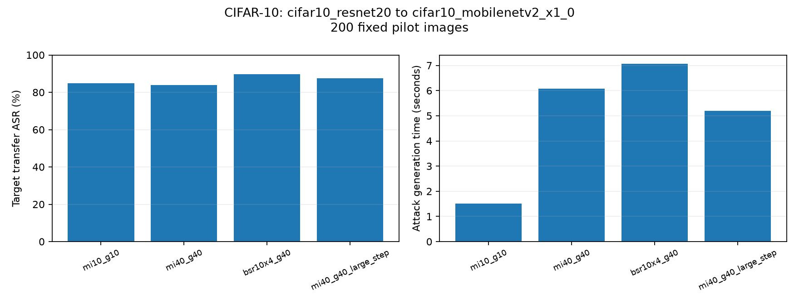
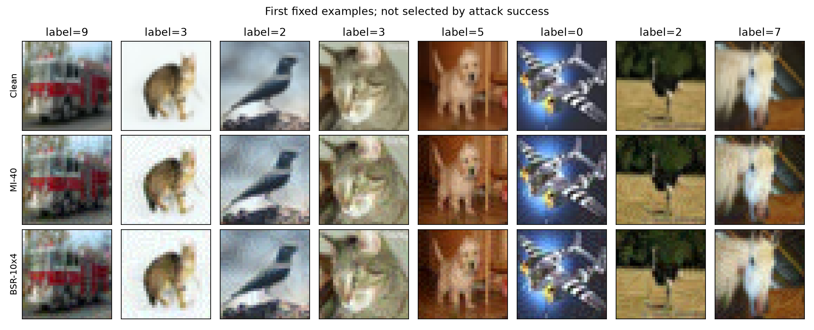

# V1 首轮预实验：等梯度预算下 BSR 与 MI-FGSM

完成时间：2026-11-18T00:12:08+08:00。这是 200 张固定图片、一个 BSR 基础种子、一个源/目标组合的真实预实验。

## 实验条件

- 源模型：`cifar10_resnet20`；目标模型：`cifar10_mobilenetv2_x1_0`。
- CIFAR-10，非定向 L∞，epsilon=0.0313725490（8/255），零起点，batch=20。
- BSR 每轴 2 块、±10° 双线性旋转、零填充，batch 内共享随机几何；每批种子为 42 加批次号。
- 配置、类别平衡且固定打乱的测试 IDs、源码和模型哈希先冻结；攻击全部生成后，目标模型才在本次进程中参与测试评价。
- 目标不提供攻击梯度，也不用于挑选参数。全测试集干净准确率用于检查权重/预处理，攻击结果仅针对固定预实验子集。
- 本实验没有调用模型服务，API 调用数为 0。

## 正常推理与约束

源模型完整测试集干净准确率：92.60%（9260/10000）。
目标模型完整测试集干净准确率：94.05%（9405/10000）。

四组攻击合计执行 26,000 次样本–视图梯度评估，预热另列。逐图像素和 L∞ 约束全部通过。

实现验证通过 50 项测试和 51 个子测试。另用独立脚本重新计算逐图 CSV 的分母、ASR 和预算，并逐个加载保存的对抗样本，对官方缓存原图核验扰动边界，均通过；该审计未调用模型，也未重新计算 bootstrap 区间，见[独立审计](independent-audit.json)。

执行前的[开发检查](development.json)只使用 50 张训练集图片，源原图准确率为 100%，四次变换后的准确率为 60%、84%、62%、60%，并保存[变换样例](development_transforms.png)。这些图片可能参与公开权重训练，不是训练外泛化证据；本轮未据最终目标结果调整变换。

## 对照结果

| 方法 | 每图梯度 G | 步长 α | 目标成功数/原图认对数 | 目标迁移 ASR | 源白盒 ASR | 攻击耗时/s | 峰值分配显存/MiB |
| --- | ---: | ---: | ---: | ---: | ---: | ---: | ---: |
| mi10_g10 | 10 | 0.800/255 | 163/192 | 84.90% | 100.00% | 1.510 | 56.0 |
| mi40_g40 | 40 | 0.200/255 | 161/192 | 83.85% | 100.00% | 6.083 | 56.0 |
| bsr10x4_g40 | 40 | 0.800/255 | 172/192 | 89.58% | 98.91% | 7.062 | 56.9 |
| mi40_g40_large_step | 40 | 0.800/255 | 168/192 | 87.50% | 100.00% | 5.191 | 56.0 |

ASR 分母是该目标在同一批原图上认对的图片数；全体图片的扰动后准确率另见 CSV。



## 配对差及其不确定性

下表为 BSR 减去各基线的 ASR 差，单位为百分点；95% 区间来自按图片聚类的配对 bootstrap，条件于本次模型及种子。

| 比较 | 差值/百分点 | 95% 区间/百分点 |
| --- | ---: | --- |
| bsr_minus_mi10_g10 | +4.69 | [+0.00, +9.42] |
| bsr_minus_mi40_g40 | +5.73 | [+1.03, +11.00] |
| bsr_minus_mi40_g40_large_step | +2.08 | [-3.08, +7.22] |

MI-10 是低预算参考；主要对照是 MI-40，另完整报告 MI-40 大步长敏感性。不能只选择有利步长或比较对象。

本轮 BSR 比主基线高 5.73 个百分点，但相对 MI-40 大步长配置只高 2.08 个百分点，后者的配对 95% 区间为 [-3.08, +7.22]，包含零。因此可以报告“观察到更高点估计”，目前不能断言 BSR 相对较强 MI 配置有稳定优势。源模型上 MI 四十步达到 100% 白盒 ASR，BSR 为 98.91%，白盒更强不直接等于迁移更强。

BSR 本轮攻击生成耗时 7.062 秒，主 MI-40 为 6.083 秒，大步长 MI-40 为 5.191 秒。BSR 没有在本轮同时取得更短耗时；这些仍是单次观测，不能据此确定时间效率的普遍排序。

目标完整测试准确率实测 94.05%，作者缓存元信息中的参考表为 93.79%；本报告保留实际观测，不把参考表数值替代本机结果，也不据此调整模型或攻击参数。

## 固定顺序样例



上图取冻结顺序的前 8 张，未按攻击成功挑选。

## 复现与原始证据

按 [V1 运行指南](../../../guides/v1-experiments.md) 准备环境与资产，在项目 02 根目录执行：

```bash
python -m course_tools.v1_assets --offline
python -m pytest tests/test_v1_attacks.py tests/test_v1_metrics.py tests/test_v1_runner.py -q
python -m course_tools.run_v1 --stage develop
python -m course_tools.run_v1 --stage pilot --config configs/v1_budget.json
```

- [本次冻结配置](config.frozen.json)、[数据 IDs](selection.json)、[来源与环境](provenance.json)。
- [逐图预测](predictions.csv)、[汇总 CSV](summary.csv)、[完整指标与配对区间](results.json)。
- [证据 SHA256 与测试摘要](verification.json)。
- 本机原始运行目录：`experiments/v1_pilot_20261118_001141/`，含完整对抗样本、每组计数及源码快照，未复制权重或完整对抗样本到报告。

## 局限与后续

这是小样本预实验，尚未完成第二目标、多个 BSR 种子、预算曲线、ImageNet 复现、防御评价或完整论文生成。
固定随机种子控制采样，但 CUDA 双线性旋转反传可能不确定。区间不包含独立训练或全部攻击随机性的变化。
相同 G 不保证相同 FLOPs 或耗时；表中耗时是单轮同步观测，含变换和结果转 CPU，不含预热及目标评价，不能当作稳定时间效率结论。
保持本次参数冻结后，优先扩展预先声明的样本与第二目标，并增加 BSR 种子；如改变协议，应记录版本并使用预留的新评价样本。
没有观察到优势不等于证明方法等价；本报告不声称提出新算法或达到发表所需的新颖性。
