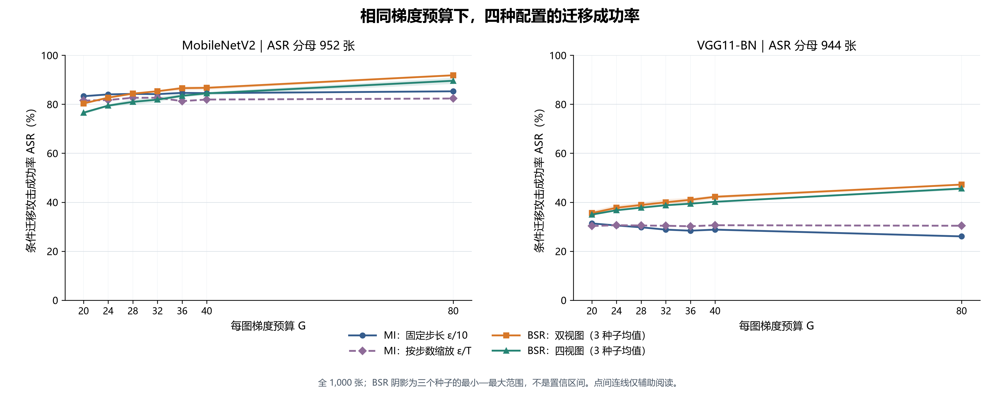
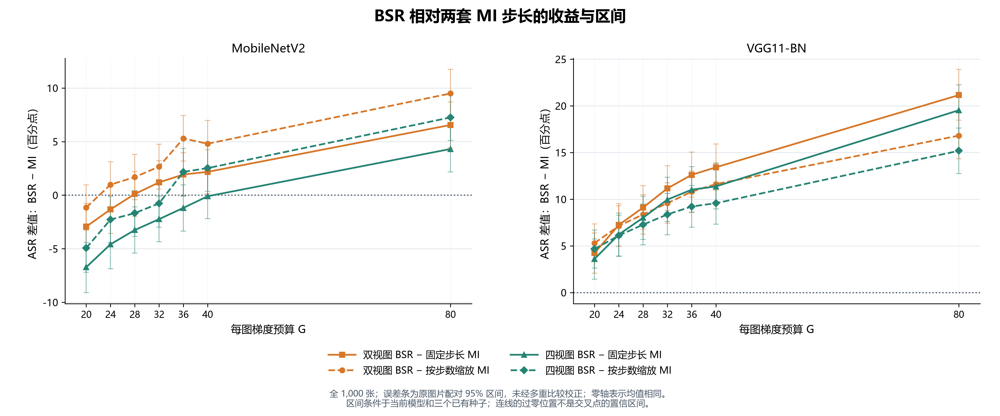
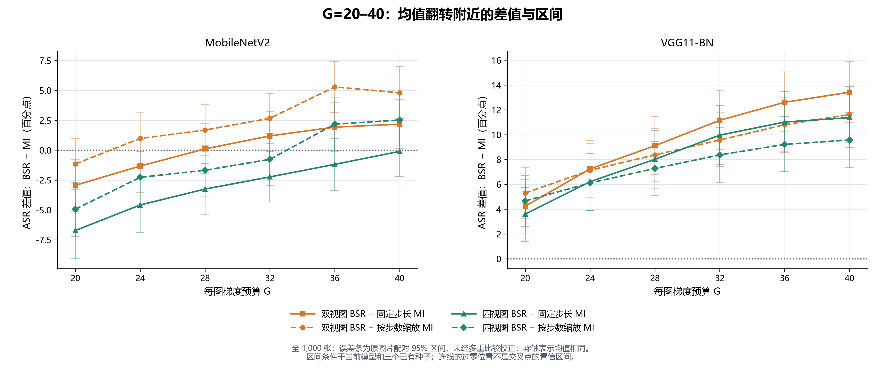
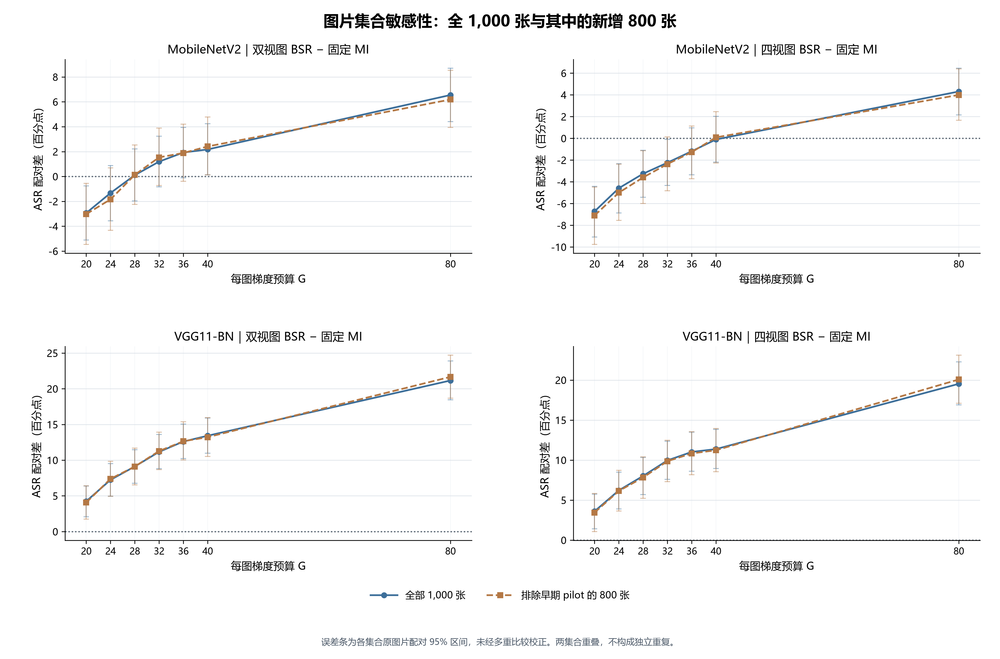
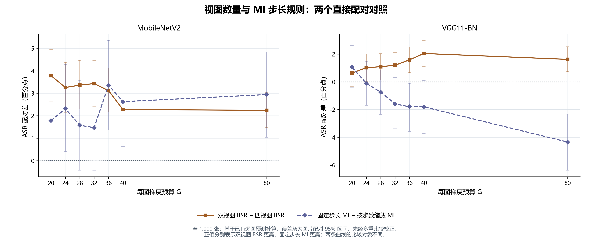
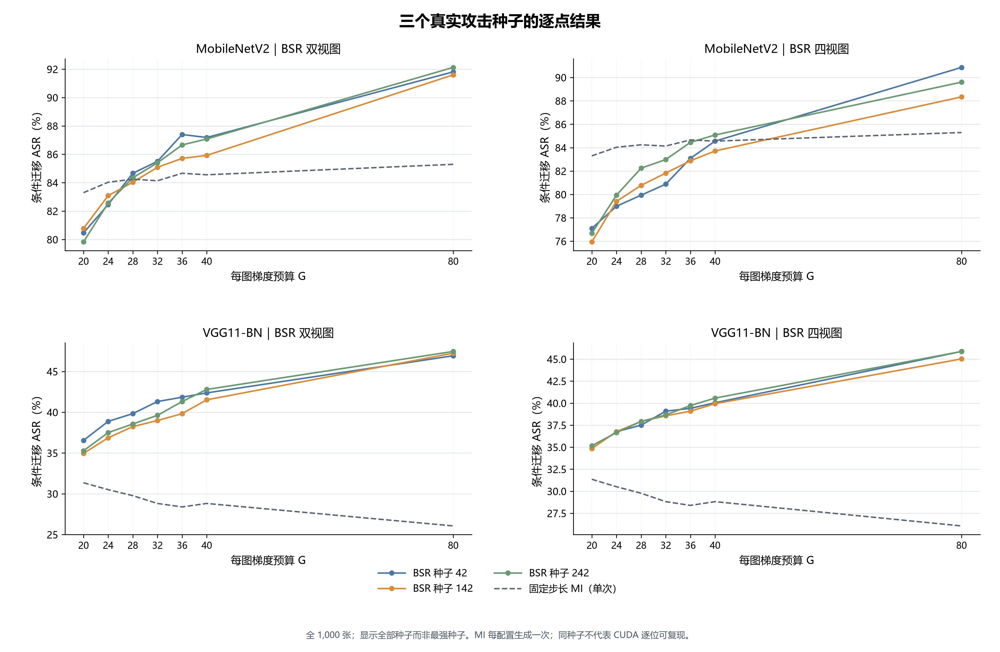
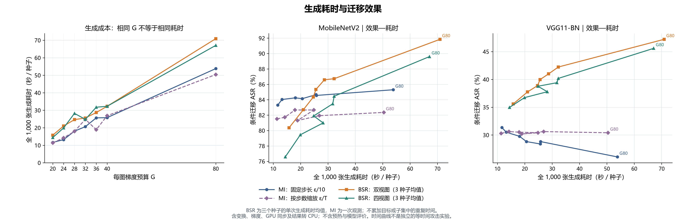

# V1 细预算实验：中文可视化、全部对照与优化建议

实际运行：`v1_crossover_manual_01`；完成时间：2026-11-18T17:45:49+08:00。本页和工作簿基于这次已完成数据；后处理没有生成新攻击、运行模型或调用 API。

## 先看什么

- 打开 [中文结果工作簿](实验结果_中文解读.xlsx)：先看“结果总览”，再在“配对比较”筛选目标、图片集合与比较类型。
- 图表位于 [figures](figures/)，每图同时提供 PNG 和 SVG；图中预算使用真实数值间距。
- [中文方法汇总](data/方法汇总_中文.csv)、[中文种子明细](data/种子明细_中文.csv)、[中文原配对比较](data/原配对比较_中文.csv)、[完整中文逐图预测](data/完整逐图预测_中文.csv) 保留所有记录。原四 CSV 没有修改。
- [全部六种方法对的配对表](data/all_comparisons.csv) 另含直接比较“双视图−四视图”“固定 MI−按步数缩放 MI”，并保留原图片区间及另算的统计敏感性结果。

## 实验问题与实际范围

固定 ResNet20 为代理，在 MobileNetV2 与 VGG11-BN 上评价迁移攻击；1,000 张固定 CIFAR-10 图片，BSR 基础种子 42/142/242，epsilon=8/255，batch=20，分块 2、旋转 ±10°。预算 G=20/24/28/32/36/40/80，每图 G=T×M。

| 方法 | 每步视图 M | 更新步数 T | 步长 alpha |
| --- | ---: | --- | --- |
| MI 固定步长 | 1 | G | epsilon/10 |
| MI 按步数缩放 | 1 | G | epsilon/G |
| BSR 双视图 | 2 | G/2 | epsilon/(G/2) |
| BSR 四视图 | 4 | G/4 | epsilon/(G/4) |

共有 28 个方法配置、56 个唯一生成任务，实际 2,080,000 次 sample-view 梯度。目标共用同一批对抗样本。源攻击生成后才评价目标。

## 可以支持的主要观察

1. **收益依赖预算与目标。** Mobile 的低预算 BSR 可以低于 MI；VGG 在当前已采样点上两种 BSR 的均值均高于两种 MI。
2. **双视图均值在两个目标、七个预算的 14 格均高于四视图。** 每格的直接配对区间和多重比较敏感性结果另列；不能把均值排序推广为所有条件都显著或全局最优。
3. **MI 步长影响结论。** Mobile 的固定步长均值较高；VGG 除 G20 外是按步数缩放的 MI 较高。G80 的双视图对 VGG 相对两者分别高 21.15 和 16.81 个百分点，两者均报告。
4. **观察到均值翻转，但边界尚不稳定。** Mobile 双视图−固定 MI 在 G24–G28 变号，两端原配对区间均跨零。G28 三个种子的差值为 +0.42、−0.21、+0.11 个百分点，均值约 +0.11，不能称精确稳定阈值。

## 全 1,000 张：四方法成功率

条件 ASR 的分母是各目标原图认对的图片：Mobile 952，VGG 944。BSR 为三个种子均值，MI 每配置一次。

| 目标 | G | MI 固定步长 | MI 按步数缩放 | BSR 双视图 | BSR 四视图 |
| --- | ---: | ---: | ---: | ---: | ---: |
| MobileNetV2 | 20 | 83.30% | 81.51% | 80.36% | 76.58% |
| MobileNetV2 | 24 | 84.03% | 81.72% | 82.70% | 79.45% |
| MobileNetV2 | 28 | 84.24% | 82.67% | 84.35% | 80.99% |
| MobileNetV2 | 32 | 84.14% | 82.67% | 85.33% | 81.90% |
| MobileNetV2 | 36 | 84.66% | 81.30% | 86.59% | 83.47% |
| MobileNetV2 | 40 | 84.56% | 81.93% | 86.73% | 84.45% |
| MobileNetV2 | 80 | 85.29% | 82.35% | 91.84% | 89.60% |
| VGG11-BN | 20 | 31.36% | 30.30% | 35.59% | 34.96% |
| VGG11-BN | 24 | 30.51% | 30.61% | 37.75% | 36.72% |
| VGG11-BN | 28 | 29.77% | 30.51% | 38.88% | 37.78% |
| VGG11-BN | 32 | 28.81% | 30.40% | 39.97% | 38.77% |
| VGG11-BN | 36 | 28.39% | 30.19% | 41.00% | 39.41% |
| VGG11-BN | 40 | 28.81% | 30.61% | 42.23% | 40.18% |
| VGG11-BN | 80 | 26.06% | 30.40% | 47.21% | 45.59% |



## 全部 BSR−MI 对照

下表单位均为百分点：正数表示 BSR 较高，负数表示 MI 较高。完整 95% 图片配对区间和 Holm 敏感性列在工作簿、CSV 中，不能把任何正数都称为稳定提升。

### MobileNetV2

| G | 双视图−固定 MI | 双视图−缩放 MI | 四视图−固定 MI | 四视图−缩放 MI |
| ---: | ---: | ---: | ---: | ---: |
| 20 | -2.94 | -1.16 | -6.72 | -4.94 |
| 24 | -1.33 | +0.98 | -4.59 | -2.28 |
| 28 | +0.11 | +1.68 | -3.26 | -1.68 |
| 32 | +1.19 | +2.66 | -2.24 | -0.77 |
| 36 | +1.93 | +5.29 | -1.19 | +2.17 |
| 40 | +2.17 | +4.80 | -0.11 | +2.52 |
| 80 | +6.55 | +9.49 | +4.31 | +7.25 |

### VGG11-BN

| G | 双视图−固定 MI | 双视图−缩放 MI | 四视图−固定 MI | 四视图−缩放 MI |
| ---: | ---: | ---: | ---: | ---: |
| 20 | +4.24 | +5.30 | +3.60 | +4.66 |
| 24 | +7.24 | +7.13 | +6.21 | +6.11 |
| 28 | +9.11 | +8.37 | +8.02 | +7.27 |
| 32 | +11.16 | +9.57 | +9.96 | +8.37 |
| 36 | +12.61 | +10.81 | +11.02 | +9.22 |
| 40 | +13.42 | +11.62 | +11.37 | +9.57 |
| 80 | +21.15 | +16.81 | +19.53 | +15.18 |





## 均值翻转位置与不确定性

| 目标 | 对照 | 全1000张采样均值翻转 | 新增800张采样均值翻转 |
| --- | --- | --- | --- |
| MobileNetV2 | BSR双视图−MI固定步长 | G24–G28（负转正） | G24–G28（负转正） |
| MobileNetV2 | BSR双视图−MI按步数缩放 | G20–G24（负转正） | G20–G24（负转正） |
| MobileNetV2 | BSR四视图−MI固定步长 | G40–G80（负转正） | G36–G40（负转正） |
| MobileNetV2 | BSR四视图−MI按步数缩放 | G32–G36（负转正） | G32–G36（负转正） |
| VGG11-BN | BSR双视图−MI固定步长 | 已采样点未观察到翻转 | 已采样点未观察到翻转 |
| VGG11-BN | BSR双视图−MI按步数缩放 | 已采样点未观察到翻转 | 已采样点未观察到翻转 |
| VGG11-BN | BSR四视图−MI固定步长 | 已采样点未观察到翻转 | 已采样点未观察到翻转 |
| VGG11-BN | BSR四视图−MI按步数缩放 | 已采样点未观察到翻转 | 已采样点未观察到翻转 |

Mobile 双视图−固定 MI：G24 差 −1.33，原区间 [−3.57,+0.88]；G28 差 +0.11，原区间 [−1.98,+2.21]。所以目前定位的是**采样均值翻转区间**，不是交叉点的 95% 置信区间。

Mobile 四视图−固定 MI 的全1000与新增800翻转区间不同：G40 的差分别仅 −0.11 和 +0.09 个百分点，区间都跨零。这是边界对图片选择敏感的证据，不能选其中一份作为确定阈值。

VGG 在当前全部已采样点的四条 BSR−MI 对照均为正；准确表述为“已采样预算内未观察到交叉”。连接线只帮助阅读，不保证连续、单调或唯一交叉。



## 新补的两个直接对照

“双视图−四视图”正数表示双视图较高；“固定 MI−缩放 MI”正数表示固定步长较高。Holm p 是另外的按原 batch 聚类 t 近似、在该集合全部 84 个方法对内统一校正的事后敏感性结果。

| 目标 | G | 双视图−四视图／pp | Holm p | 固定 MI−缩放 MI／pp | Holm p |
| --- | ---: | ---: | ---: | ---: | ---: |
| MobileNetV2 | 20 | +3.78 | 1.33e-05 | +1.79 | 1 |
| MobileNetV2 | 24 | +3.26 | 7.44e-07 | +2.31 | 0.784 |
| MobileNetV2 | 28 | +3.36 | 9.86e-07 | +1.58 | 1 |
| MobileNetV2 | 32 | +3.43 | 8.64e-06 | +1.47 | 1 |
| MobileNetV2 | 36 | +3.12 | 1.12e-05 | +3.36 | 0.116 |
| MobileNetV2 | 40 | +2.28 | 0.000391 | +2.63 | 0.564 |
| MobileNetV2 | 80 | +2.24 | 0.000495 | +2.94 | 0.079 |
| VGG11-BN | 20 | +0.64 | 1 | +1.06 | 1 |
| VGG11-BN | 24 | +1.02 | 1 | -0.11 | 1 |
| VGG11-BN | 28 | +1.09 | 1 | -0.74 | 1 |
| VGG11-BN | 32 | +1.20 | 0.259 | -1.59 | 1 |
| VGG11-BN | 36 | +1.59 | 0.0612 | -1.80 | 1 |
| VGG11-BN | 40 | +2.05 | 0.00118 | -1.80 | 1 |
| VGG11-BN | 80 | +1.62 | 0.0108 | -4.34 | 0.0108 |

例如 VGG G20 双视图−四视图虽为 +0.64pp，原图片区间 [−0.32,+1.59] 仍跨零；G40 为 +2.05pp，原区间 [+1.12,+2.99]，本次 84 项 Holm 近似 p≈0.00118。不要把全部 14 格均值为正，改写成每格都有同等强的证据。



## 时间、稳定性与成本

时间来自原 56 个唯一生成任务，包含变换、梯度、GPU 同步和结果转 CPU，不含预热与源／目标评价。每行时间指完整 1,000 张的单种子生成成本；BSR 三种子取平均。

| G | MI 固定步长／秒 | MI 按步数缩放／秒 | BSR 双视图／秒 | BSR 四视图／秒 |
| ---: | ---: | ---: | ---: | ---: |
| 20 | 11.64 | 11.35 | 15.78 | 14.40 |
| 24 | 13.23 | 14.25 | 21.01 | 19.91 |
| 28 | 18.08 | 17.95 | 24.65 | 28.23 |
| 32 | 20.63 | 24.85 | 25.60 | 24.80 |
| 36 | 25.66 | 18.89 | 28.70 | 31.75 |
| 40 | 25.79 | 26.88 | 32.27 | 32.27 |
| 80 | 53.82 | 50.39 | 70.91 | 67.08 |

所有唯一任务的攻击生成耗时合计 1645.52 秒，约 27.43 分钟。两个目标和三个集合中的重复时间字段不能再次加总，也不能说 new800 单独测了相同时间。

G40→G80，双视图在 Mobile/VGG 的 ASR 分别提高 5.11/4.98 个百分点，单种子平均生成时间由 32.27 秒增到 70.91 秒，约 2.20 倍。是否值得增加预算，应同时看收益和成本；同梯度预算不等于等运行时间。

三个种子的波动也有目标依赖：Mobile 上双视图样本标准差通常较小，VGG 上四视图反而较小。成功率种子标准差不是梯度方差，更不是总体重复性保证。





## 建议下一步怎样优化

1. **优先确认 Mobile 双视图边界。** 单独保留 M2，在 G24/26/28 看局部变化。共同包含 M4 的配置不能运行 G26；若要升级为稳定设计建议，冻结设置后使用新种子或未参与当前选参的图片确认。
2. **按问题决定其他补点。** 若仍关心四视图的高预算翻转，可先补 G60；若关心 VGG 更低预算是否仍获益，可另扫共同合法的 G4/8/12/16。两条视图曲线分别解释，允许没有观察到交叉。
3. **在改算法前先判断成本。** G40到80的双视图约多花一倍时间换约5pp。根据课程目标选择预算；如果优化实现速度，保持变换分布、梯度平均、动量、投影和 batch 分组语义一致，并在相同条件下重复计时。改变 batch 也会改变共享几何分组，不能只记为性能开关。

以上为后续建议，未在本次可视化中运行；没有添加新的代理模型、图片或攻击种子。

## 统计口径与可信度边界

- 原运行有每集合 56 项 BSR−MI 对照；本次再补 M2−M4、两 MI 步长的直接比较，共每集合 84 项、三个集合 252 行。新直接图片区间仅用已有预测重采样计算。
- 原图片区间和新增图片区间均是图片配对 percentile 95% 区间、10,000 次重采样，条件于当前模型与三个已经实现的攻击种子，没有覆盖模型训练或所有随机性的变化。
- Holm 主列来自原 batch 聚类标准误和 t 近似，分别在 full1000/new800/pilot200 的各 84 项家族中校正；不宣称三个家族联合控制。BH 仅探索，其依赖条件未验证。
- Bonferroni cluster-t 近似同时区间单独列出，不能称为 Holm 或 BH 区间。两套区间采用不同推断口径，不要求数值完全一致。
- Mobile G40 双视图−固定 MI 的原区间略高于零，但本次扩展家族的 Holm 近似分析未拒绝零差异；G80 的 +6.55pp 在该敏感性检查中保留。
- 全1000包含原pilot200；new800与全1000重叠，且二者现在都已看过结果，不能当独立确认。未拒绝零差异不等于证明等效。
- 配置原 notes 仍写最细间隔2及偶数补点；当前实际预算均为4的倍数，因此本次运行合法。后续包含M4时最细共同间隔为4，且 notes 不会自动执行补点。

## 复查与复现后处理

- [冻结配置](../../../../experiments/v1_crossover_manual_01/config.frozen.json)、[数据编号](../../../../experiments/v1_crossover_manual_01/selection.json)、[原始来源](../../../../experiments/v1_crossover_manual_01/provenance.json) 与 [完成校验](../../../../experiments/v1_crossover_manual_01/completion.json)。
- [本次加工元数据](analysis.json)、[后处理检查与文件哈希](verification.json)。
- [全1000统计明细](statistics/full1000/report.md)、[新增800统计明细](statistics/new800/report.md)、[原200统计明细](statistics/pilot200/report.md)。
- 原始数据、预测、配置和源码快照均保留；本报告没有重新运行模型。独立复核见 [audit.json](audit.json)。

重新生成统计时，在现有 Ubuntu 项目环境运行下列命令，输出目录选择全新名称：

```bash
python /mnt/e/SecAI-code/xidian-ai-security-class-project-new/projects/project-02-ai-scientist-v2/docs/reports/2026-11-18/v1-crossover-manual-01/reproduce_analysis.py \
  --run /mnt/e/SecAI-code/xidian-ai-security-class-project-new/projects/project-02-ai-scientist-v2/experiments/v1_crossover_manual_01 \
  --output /mnt/e/SecAI-code/xidian-ai-security-class-project-new/projects/project-02-ai-scientist-v2/docs/reports/2026-11-18/v1-crossover-manual-01-reproduce
```

图表可以用 `python -m course_tools.plot_v1_manual_results --run <原运行目录> --output <新图目录> --extra-comparisons <本报告>/data/all_comparisons.csv` 从已保存 CSV 重画。当前绘图模板针对本次两目标、双／四视图与三个原种子；改变实验结构后，应同步核对标签与校验，不能直接沿用旧结论。

独立审计脚本为 `independent_audit.py --run <原运行目录> --report <本报告目录> --output /tmp/audit-v1-manual.json`，仅使用标准库和 NumPy，输出须放在两个输入目录之外。本次复核了全部 252 个点差、聚类标准误和 Holm 调整，以及五个新增图片区间；未独立重算所有区间、Student-t 尾概率或模型预测。
