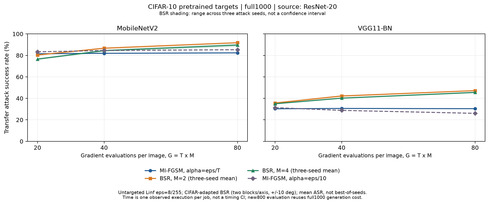
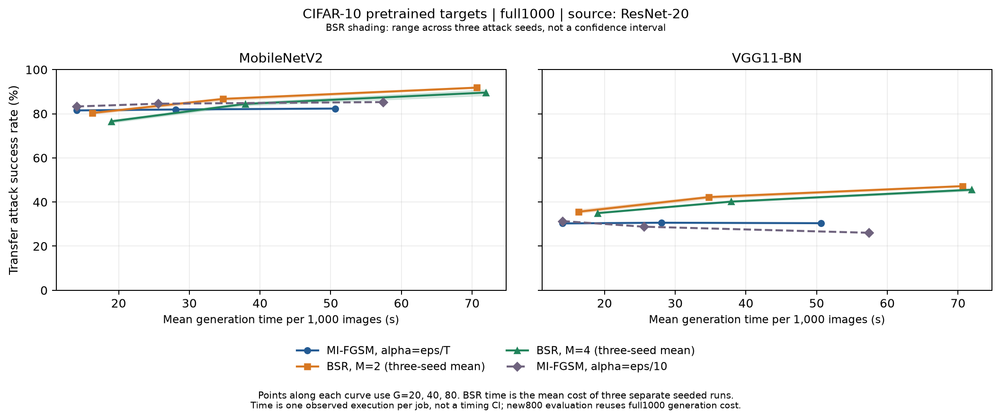
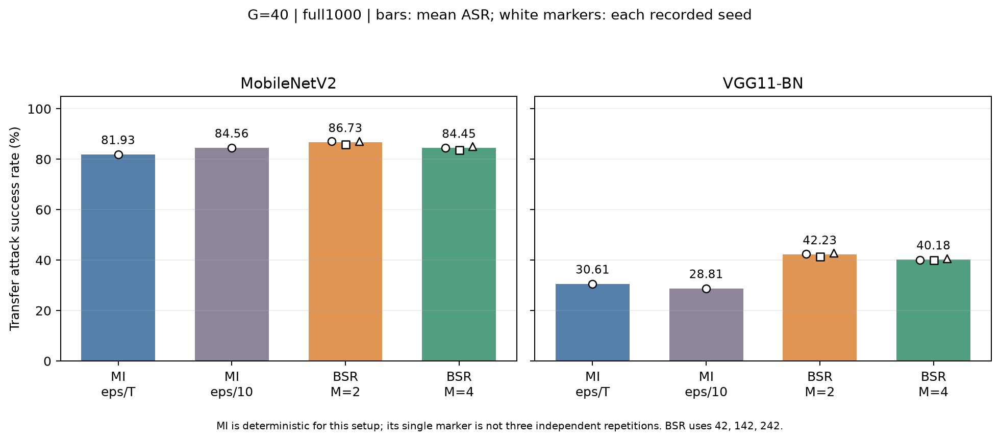
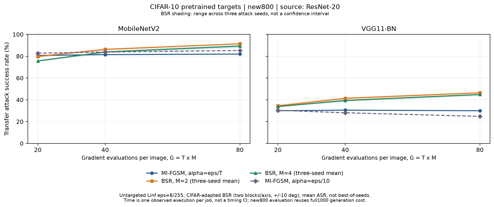
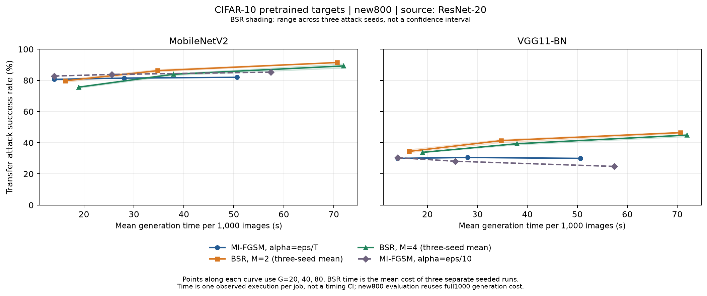
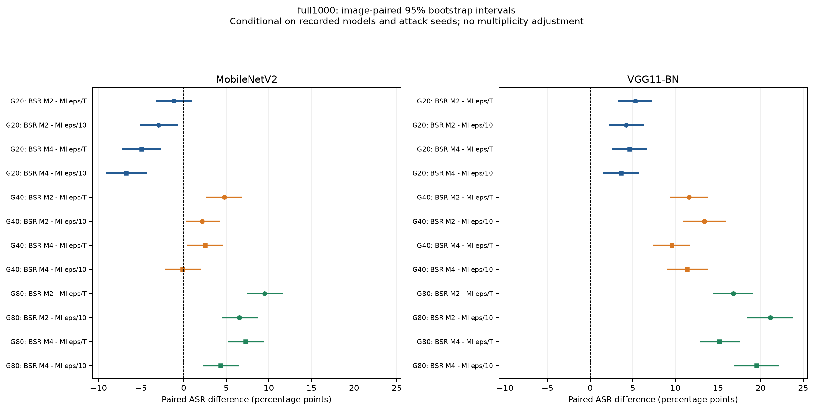
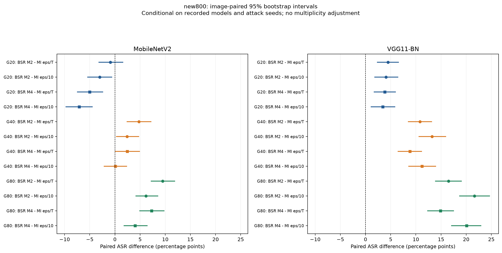
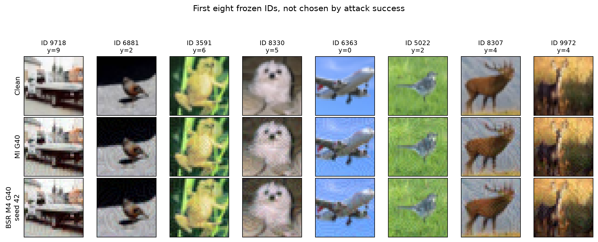
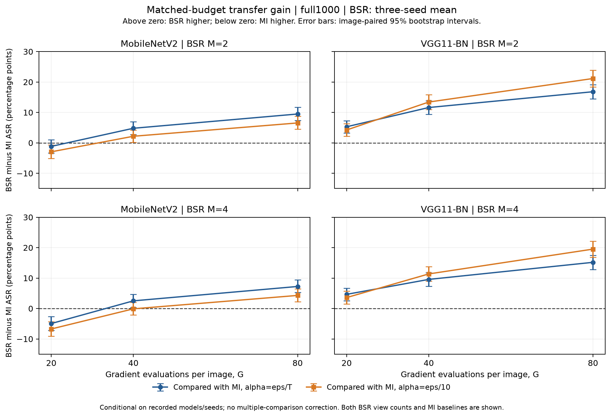
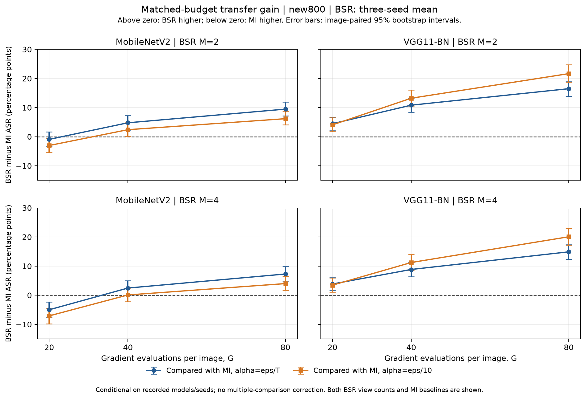

# V1 完整实验：固定梯度预算下的空间视图与迭代深度

完成时间：2026-11-18T12:31:30+08:00。本报告来自已完成的本机 CUDA 实验，源码、冻结配置、数据 IDs、权重哈希与逐图预测均有对应记录。

## 研究问题与方法

同样的计算预算，用于更多 MI-FGSM 更新，还是用于每轮更多 BSR 空间变换视图，哪种分配更有利于黑盒迁移？本实验评价已存在攻击策略的资源分配，不声称提出新攻击算法。

源模型 ResNet-20 提供梯度。攻击生成时只使用源模型；所有对抗样本生成并缓存后，分别交给 MobileNetV2 和 VGG11-BN 评价，两目标共用完全相同的对抗样本。三个模型均使用来源明确的 CIFAR-10 预训练权重，模型参数保持冻结。

非定向 L∞，ε=8/255，零起点，动量系数 1。BSR 使用每轴 2 块、±10°、双线性插值、零填充，随机几何在 batch 内共享。它是 CIFAR 小图适配配置，不能直接当作原论文 ImageNet 复现。

每图预算 G=T×M。M=1 端点使用原图 MI-FGSM；BSR 使用 M=2/4，T=G/M，主步长 α=ε/T。每个 G 另设 MI α=ε/10 的敏感性对照，保留 MI-10 低预算参考。

| G | MI 步数/原图 | BSR M=2 步数 | BSR M=4 步数 | MI 固定步长敏感性 |
| ---: | ---: | ---: | ---: | --- |
| 20 | 20 | 10 | 5 | α=ε/10，20 步 |
| 40 | 40 | 20 | 10 | α=ε/10，40 步 |
| 80 | 80 | 40 | 20 | α=ε/10，80 步 |

BSR 每配置运行基础种子 42、142、242，报告每种子及其均值；MI 在此零起点、eval 配置下每配置运行一次。种子平均不是 best-of-three，也不代表三个独立训练模型。

## 数据与评价口径

沿用首轮预先固定的 1,000 张 CIFAR-10 测试 IDs，每类 100 张。该集合包含首轮 200 张，所以分别报告 full1000、pilot200 和 new800。new800 是未参与首轮攻击效果评价的 800 张，并非从未访问过目标：首轮已经检查过完整测试集的干净准确率。

本轮按完整 1,000 张的冻结顺序重新生成攻击，pilot200 指本轮生成结果中对应的子集。BSR 在 batch 内共享几何，图片与批次的对应关系可能不同，因此即使基础种子仍为 42，该子集也不是旧的独立 200 张运行的原样缓存或精确重现；旧预实验记录另行保留。

ASR 分母为每个目标、每个子集上原图认对的数量；所有方法共享该目标/子集的分母。全体固定图片上的扰动后准确率另行报告，不以 1−ASR 直接替代。

所有配置提前冻结，不依据本轮目标结果挑块数、角度、步长、种子或目标。三个种子按同一图片聚合；配对 bootstrap 每次将同一图片的所有方法/种子一起重采样。95% 区间条件于本次固定模型与已记录种子，不包含独立训练的不确定性；多组对照区间未作多重比较校正。

## 模型正常推理与计算核验

源模型完整测试集准确率：92.60%（9260/10000）。

| 目标 | 完整测试集干净准确率 | 正确数/总数 |
| --- | ---: | ---: |
| MobileNetV2 | 94.05% | 9405/10000 |
| VGG11-BN | 92.79% | 9279/10000 |

本轮实际攻击生成合计 1,130,000 次样本–视图梯度评估。25 个生成任务的结果复用于两个目标；预热/开发诊断计算另列。每个视图合批不减少 G 计数。

## G=40 的主对照

### 全部 1,000 张

| 目标 | 方法 | 平均成功数/原图认对数 | ASR | 各种子 ASR 范围 | 源白盒 ASR | 平均生成时间/s |
| --- | --- | ---: | ---: | --- | ---: | ---: |
| MobileNetV2 | MI G=40, α=ε/T | 780/952 | 81.93% | 81.93%–81.93% | 100.00% | 28.034 |
| MobileNetV2 | MI G=40, α=ε/10 | 805/952 | 84.56% | 84.56%–84.56% | 100.00% | 25.560 |
| MobileNetV2 | BSR M=2, G=40 | 825.667/952 | 86.73% | 85.92%–87.18% | 99.29% | 34.763 |
| MobileNetV2 | BSR M=4, G=40 | 804/952 | 84.45% | 83.72%–85.08% | 98.75% | 37.921 |
| VGG11-BN | MI G=40, α=ε/T | 289/944 | 30.61% | 30.61%–30.61% | 100.00% | 28.034 |
| VGG11-BN | MI G=40, α=ε/10 | 272/944 | 28.81% | 28.81%–28.81% | 100.00% | 25.560 |
| VGG11-BN | BSR M=2, G=40 | 398.667/944 | 42.23% | 41.53%–42.80% | 99.29% | 34.763 |
| VGG11-BN | BSR M=4, G=40 | 379.333/944 | 40.18% | 39.94%–40.57% | 98.75% | 37.921 |

### 未参与首轮攻击效果评价的 800 张

| 目标 | 方法 | 平均成功数/原图认对数 | ASR | 各种子 ASR 范围 | 源白盒 ASR | 平均生成时间/s |
| --- | --- | ---: | ---: | --- | ---: | ---: |
| MobileNetV2 | MI G=40, α=ε/T | 619/760 | 81.45% | 81.45%–81.45% | 100.00% | 28.034 |
| MobileNetV2 | MI G=40, α=ε/10 | 637/760 | 83.82% | 83.82%–83.82% | 100.00% | 25.560 |
| MobileNetV2 | BSR M=2, G=40 | 655.333/760 | 86.23% | 85.53%–87.11% | 99.16% | 34.763 |
| MobileNetV2 | BSR M=4, G=40 | 637.667/760 | 83.90% | 83.16%–84.47% | 98.58% | 37.921 |
| VGG11-BN | MI G=40, α=ε/T | 230/754 | 30.50% | 30.50%–30.50% | 100.00% | 28.034 |
| VGG11-BN | MI G=40, α=ε/10 | 212/754 | 28.12% | 28.12%–28.12% | 100.00% | 25.560 |
| VGG11-BN | BSR M=2, G=40 | 311.667/754 | 41.34% | 40.05%–42.18% | 99.16% | 34.763 |
| VGG11-BN | BSR M=4, G=40 | 296.667/754 | 39.35% | 38.59%–39.92% | 98.58% | 37.921 |

BSR 成功数是三个种子的平均，可出现小数。时间为每配置一次种子执行的均值，均按完整 1,000 张生成计时；new800 只是在同一批缓存上重新评价，不能把这个时间称为单独生成 800 张的耗时。目标数增加前向评价成本，不增加重复攻击生成成本。

## 预算曲线与种子变化

### 全部 1,000 张







### 新增 800 张






曲线阴影表示三个 BSR 种子的范围，不是置信区间；它展示变换随机性。相同 G 不保证相同 FLOPs 或耗时。计时含变换、GPU 同步与结果转 CPU，不含预热、源/目标评价；这是单次执行的观测，未做独立计时重复。

## 配对差与可支持的结论

主比较为 BSR 减去同 G 的 MI 主基线，并完整保留 MI 固定步长敏感性；区间包含零表示当前证据不足以确定差异方向，不表示已证明等价。

### 全部 1,000 张



| 目标 | G | BSR 视图数 | MI 步长 | ASR 差/百分点 | 95% 区间/百分点 |
| --- | ---: | ---: | --- | ---: | --- |
| MobileNetV2 | 20 | 2 | ε/T | -1.16 | [-3.28, +0.97] |
| MobileNetV2 | 20 | 2 | ε/10 | -2.94 | [-5.08, -0.71] |
| MobileNetV2 | 20 | 4 | ε/T | -4.94 | [-7.23, -2.68] |
| MobileNetV2 | 20 | 4 | ε/10 | -6.72 | [-9.07, -4.32] |
| MobileNetV2 | 40 | 2 | ε/T | +4.80 | [+2.69, +6.90] |
| MobileNetV2 | 40 | 2 | ε/10 | +2.17 | [+0.21, +4.25] |
| MobileNetV2 | 40 | 4 | ε/T | +2.52 | [+0.35, +4.67] |
| MobileNetV2 | 40 | 4 | ε/10 | -0.11 | [-2.15, +2.00] |
| MobileNetV2 | 80 | 2 | ε/T | +9.49 | [+7.41, +11.70] |
| MobileNetV2 | 80 | 2 | ε/10 | +6.55 | [+4.52, +8.72] |
| MobileNetV2 | 80 | 4 | ε/T | +7.25 | [+5.25, +9.44] |
| MobileNetV2 | 80 | 4 | ε/10 | +4.31 | [+2.25, +6.45] |
| VGG11-BN | 20 | 2 | ε/T | +5.30 | [+3.22, +7.23] |
| VGG11-BN | 20 | 2 | ε/10 | +4.24 | [+2.18, +6.29] |
| VGG11-BN | 20 | 4 | ε/T | +4.66 | [+2.56, +6.65] |
| VGG11-BN | 20 | 4 | ε/10 | +3.60 | [+1.47, +5.76] |
| VGG11-BN | 40 | 2 | ε/T | +11.62 | [+9.40, +13.81] |
| VGG11-BN | 40 | 2 | ε/10 | +13.42 | [+10.92, +15.88] |
| VGG11-BN | 40 | 4 | ε/T | +9.57 | [+7.36, +11.73] |
| VGG11-BN | 40 | 4 | ε/10 | +11.37 | [+8.97, +13.79] |
| VGG11-BN | 80 | 2 | ε/T | +16.81 | [+14.43, +19.16] |
| VGG11-BN | 80 | 2 | ε/10 | +21.15 | [+18.41, +23.86] |
| VGG11-BN | 80 | 4 | ε/T | +15.18 | [+12.82, +17.53] |
| VGG11-BN | 80 | 4 | ε/10 | +19.53 | [+16.88, +22.16] |

### 新增 800 张



| 目标 | G | BSR 视图数 | MI 步长 | ASR 差/百分点 | 95% 区间/百分点 |
| --- | ---: | ---: | --- | ---: | --- |
| MobileNetV2 | 20 | 2 | ε/T | -0.92 | [-3.25, +1.65] |
| MobileNetV2 | 20 | 2 | ε/10 | -3.03 | [-5.48, -0.53] |
| MobileNetV2 | 20 | 4 | ε/T | -5.00 | [-7.54, -2.36] |
| MobileNetV2 | 20 | 4 | ε/10 | -7.11 | [-9.80, -4.41] |
| MobileNetV2 | 40 | 2 | ε/T | +4.78 | [+2.33, +7.23] |
| MobileNetV2 | 40 | 2 | ε/10 | +2.41 | [+0.22, +4.79] |
| MobileNetV2 | 40 | 4 | ε/T | +2.46 | [-0.04, +4.96] |
| MobileNetV2 | 40 | 4 | ε/10 | +0.09 | [-2.22, +2.39] |
| MobileNetV2 | 80 | 2 | ε/T | +9.47 | [+7.13, +11.97] |
| MobileNetV2 | 80 | 2 | ε/10 | +6.18 | [+4.09, +8.62] |
| MobileNetV2 | 80 | 4 | ε/T | +7.28 | [+4.84, +9.85] |
| MobileNetV2 | 80 | 4 | ε/10 | +3.99 | [+1.75, +6.49] |
| VGG11-BN | 20 | 2 | ε/T | +4.47 | [+2.28, +6.63] |
| VGG11-BN | 20 | 2 | ε/10 | +4.07 | [+1.75, +6.51] |
| VGG11-BN | 20 | 4 | ε/T | +3.85 | [+1.65, +6.02] |
| VGG11-BN | 20 | 4 | ε/10 | +3.45 | [+1.04, +5.91] |
| VGG11-BN | 40 | 2 | ε/T | +10.83 | [+8.42, +13.23] |
| VGG11-BN | 40 | 2 | ε/10 | +13.22 | [+10.54, +16.00] |
| VGG11-BN | 40 | 4 | ε/T | +8.84 | [+6.40, +11.23] |
| VGG11-BN | 40 | 4 | ε/10 | +11.23 | [+8.50, +14.00] |
| VGG11-BN | 80 | 2 | ε/T | +16.49 | [+13.81, +19.14] |
| VGG11-BN | 80 | 2 | ε/10 | +21.66 | [+18.62, +24.71] |
| VGG11-BN | 80 | 4 | ε/T | +14.90 | [+12.25, +17.57] |
| VGG11-BN | 80 | 4 | ε/10 | +20.07 | [+17.02, +23.01] |

### G=40 的直接解读

- MobileNetV2、新增 800 张、BSR M=2：相对主 MI，差 +4.78 个百分点，95% 区间 [+2.33, +7.23]；本条件下区间全为正；相对固定步长 MI，差 +2.41 个百分点，95% 区间 [+0.22, +4.79]；本条件下区间全为正。
- MobileNetV2、新增 800 张、BSR M=4：相对主 MI，差 +2.46 个百分点，95% 区间 [-0.04, +4.96]；区间包含零，当前不能确定优势方向；相对固定步长 MI，差 +0.09 个百分点，95% 区间 [-2.22, +2.39]；区间包含零，当前不能确定优势方向。
- VGG11-BN、新增 800 张、BSR M=2：相对主 MI，差 +10.83 个百分点，95% 区间 [+8.42, +13.23]；本条件下区间全为正；相对固定步长 MI，差 +13.22 个百分点，95% 区间 [+10.54, +16.00]；本条件下区间全为正。
- VGG11-BN、新增 800 张、BSR M=4：相对主 MI，差 +8.84 个百分点，95% 区间 [+6.40, +11.23]；本条件下区间全为正；相对固定步长 MI，差 +11.23 个百分点，95% 区间 [+8.50, +14.00]；本条件下区间全为正。

这些观察仅支持当前源模型、两个预训练目标、数据和参数范围内的条件性判断。不能由某一目标、某一种子或某个预算的最高点推导出 BSR 普遍更好，也不能把参考模型间梯度方向称为已知的理想方向。

## 固定顺序的图像样例



图像来自冻结顺序的前八张；显示原图、MI G40 及 BSR M4 G40 的 seed42，未按攻击成功选择样例。

## 复现与审查入口

```bash
cd /home/zst/projects/xidian-ai-security-class-project-new/projects/project-02-ai-scientist-v2
source .venv/bin/activate
python -m course_tools.v1_assets --offline
python -m course_tools.run_v1_full --config configs/v1_full.json \
  --output /mnt/e/SecAI-code/xidian-ai-security-class-project-new/projects/project-02-ai-scientist-v2/experiments/v1_full_reproduce
python -m course_tools.report_v1_full \
  --run /mnt/e/SecAI-code/xidian-ai-security-class-project-new/projects/project-02-ai-scientist-v2/experiments/v1_full_reproduce \
  --output /mnt/e/SecAI-code/xidian-ai-security-class-project-new/projects/project-02-ai-scientist-v2/docs/reports/2026-11-18/v1-full-reproduce
python -m course_tools.render_v1_full_figures \
  --report /mnt/e/SecAI-code/xidian-ai-security-class-project-new/projects/project-02-ai-scientist-v2/docs/reports/2026-11-18/v1-full-reproduce
```

- [冻结配置](config.frozen.json)、[数据 IDs](selection.json)、[模型/环境/代码来源](provenance.json)。
- [汇总](summary.csv)、[各随机种子](per_seed.csv)、[逐图预测](predictions.csv)、[配对差](comparisons.csv)、[完整结果](results.json)。
- [图表和证据 SHA256、测试摘要](verification.json)。每张图另附同名 SVG，便于放入汇报。
- 本次原始结果在 Windows 的 `E:\SecAI-code\xidian-ai-security-class-project-new\projects\project-02-ai-scientist-v2\experiments\v1_full_20261118_121450\`，Ubuntu 对应 `/mnt/e/SecAI-code/xidian-ai-security-class-project-new/projects/project-02-ai-scientist-v2/experiments/v1_full_20261118_121450/`。上面的复现命令会新建另一目录，不覆盖本次证据；若复现目录已存在，应更换名称。
- 全部对抗样本与源码快照留在原始结果目录，本报告保留精选证据。图表在导出后用[独立排版程序](../../../../course_tools/render_v1_full_figures.py)把图例移到图外并去除重叠标注；该步骤读取已保存指标，不改冻结实验源码或预测，记录见 verification.json。
- 源码：[完整运行器](../../../../course_tools/run_v1_full.py)、[攻击核心](../../../../course_tools/v1_attacks.py)、[统计](../../../../course_tools/v1_metrics.py)、[报告程序](../../../../course_tools/report_v1_full.py)。
- [完整协议](../../../research/v1-full-protocol.md)与[运行指南](../../../guides/v1-experiments.md)。

本次附带的 pytest JUnit 记录 127 个 case（可能包含子测试），失败 0、错误 0、跳过 0。软件测试验证实现约束，不代替研究效果证据。

## 跨预算的实际发现与汇报结论

下表是全部 1,000 张的条件迁移 ASR；BSR 为三种子均值。MobileNetV2 的分母为 952，VGG11-BN 为 944，各目标内部保持同一分母。

| 目标 | 每图 G | MI 主步长 ε/T | MI 固定步长 ε/10 | BSR 双视图 | BSR 四视图 |
| --- | ---: | ---: | ---: | ---: | ---: |
| MobileNetV2 | 20 | 81.51% | 83.30% | 80.36% | 76.58% |
| MobileNetV2 | 40 | 81.93% | 84.56% | 86.73% | 84.45% |
| MobileNetV2 | 80 | 82.35% | 85.29% | 91.84% | 89.60% |
| VGG11-BN | 20 | 30.30% | 31.36% | 35.59% | 34.96% |
| VGG11-BN | 40 | 30.61% | 28.81% | 42.23% | 40.18% |
| VGG11-BN | 80 | 30.40% | 26.06% | 47.21% | 45.59% |

1. **预算会改变两种分配方式的相对表现。** MobileNetV2 在 G=20 时，BSR 两种配置都低于 MI；G=40 时，双视图 BSR 高于两个 MI 配置，四视图与固定步长 MI 接近；G=80 时，两种 BSR 的均值均高于两个 MI 配置。不能用一个预算点概括所有条件。
2. **目标模型会影响结论。** 在 VGG11-BN 的三个预算点，BSR 两种配置的均值均高于两个 MI 配置。源相同、扰动相同，也不能把一个目标上的成功率或优势直接推广到另一目标。
3. **更多视图并不保证更好。** 两目标、三预算共六个已测条件中，双视图 BSR 的均值均高于四视图。这支持研究视图数与更新步数之间的平衡，但不能证明双视图在所有预算、数据和架构上最优。
4. **单纯增加 MI 步数，在本轮迁移评价中的收益有限。** 主规则 MI 在两个目标上随 G 的变化较小；固定步长 MI 对 MobileNetV2 随预算增加略有提升，对 VGG11-BN 则下降。步长敏感性必须随主比较一起报告，不能择优保留一种步长。
5. **梯度预算和时间效率需要分别陈述。** G=40 的完整 1,000 张生成时间，MI 主规则为 28.03 秒、MI 固定步长为 25.56 秒，BSR 双视图为 34.76 秒、四视图为 37.92 秒（BSR 取三次单种子时间均值）。本轮 BSR 同 G 更耗时；时间曲线属于单次观测，不构成等时间优势保证。

新增 800 张的结果方向总体一致。尤其 G=40：MobileNetV2 上双视图相对固定步长 MI 高 2.41 个百分点，图片配对区间为 [+0.22,+4.79]；四视图只高 0.09 个百分点，区间 [-2.22,+2.39] 包含零。VGG11-BN 上双视图相对主规则 MI 高 10.83 个百分点，相对固定步长 MI 高 13.22 个百分点。所有区间均条件于当前权重和三个种子，且没有作多重比较校正；这些是已测条件下的实证观察。

完成状态：本次约定的 V1 矩阵、三种子、两目标和分区评价已完成。独立审计重新计算了 50,000 行预测、78 行汇总、90 个配对点差，并独立重采样核对了八个 G=40 BSR 对固定步长 MI 的区间；全部 25 份对抗样本逐图核验像素、L∞ 边界和冻结哈希。见[独立审计](independent-audit.json)。实现检查为 72 项测试、55 个子测试通过。

## 用差值图判断效果大小

总览 ASR 图使用 0–100% 纵轴，适合比较两个目标的总体水平；判断改进幅度时，下面的差值图更直接。每条曲线是同梯度预算下 BSR 减去 MI 的 ASR，单位为百分点，虚线零表示没有差异。图中保留两个目标、两种 BSR 视图数、两种 MI 步长及全部三个预算，误差条为已有图片配对区间；没有改变指标或重新选择样本。





MobileNetV2 的 G=40 四视图配置与固定步长 MI 接近，不能讲成稳定提升；但 G=80 双视图相对固定步长 MI 高 6.55 个百分点，区间 [+4.52,+8.72]。VGG11-BN 的 G=80 双视图相对主规则 MI 高 16.81 个百分点，区间 [+14.43,+19.16]。同时，MobileNetV2 在 G=20 的双视图相对固定步长 MI 低 2.94 个百分点，区间 [-5.08,-0.71]。这些条件差异支持“预算分配的效果依赖预算与目标”的表述，不支持所有设置都更强或已提出新算法的表述。

差值图可用 `python -m course_tools.plot_v1_gains --report <报告目录>` 从已保存结果重画；该步骤不调用模型或生成新攻击。

## 局限与后续

本阶段完成的是 CIFAR 上的一条源模型、两个目标、三个攻击种子及三个计算预算的 V1 评价。尚未实施训练检查点 V2、更多代理训练重复、ImageNet/Transformer 全面复现、防御评价或自动论文生成。
CUDA 双线性旋转反传可能不完全确定，固定种子主要控制采样；本报告不承诺位级一致。BSR 的共享 batch 几何与当前 batch/顺序共同构成实验条件。
全 1,000 张包含已看到的 200 张；新增 800 张单独呈现。报告任何新协议或参数选择时，都应另留评价数据，避免把已参与选择的目标结果当成独立确认。
后续工作由这些条件性结果决定；无论是否观察到 BSR 优势，本阶段都能交付可复现代码、完整对照、预算与时间分析，以及限制说明。
